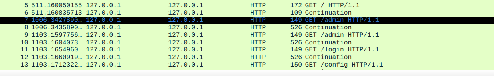
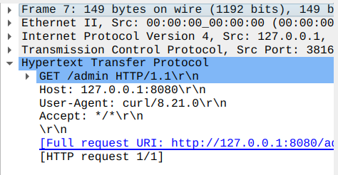
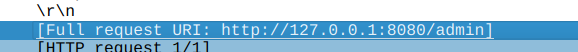
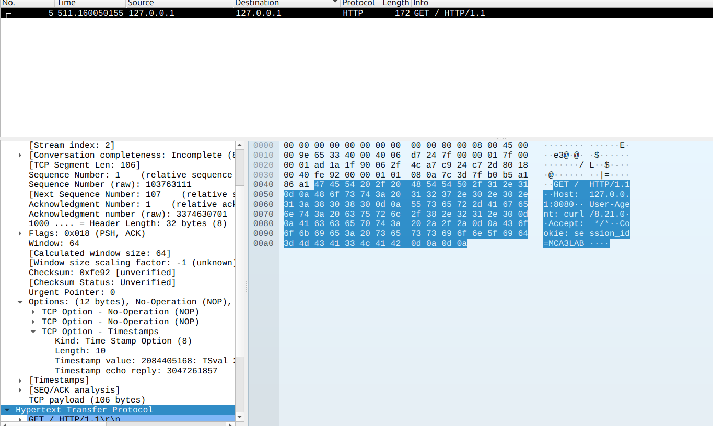
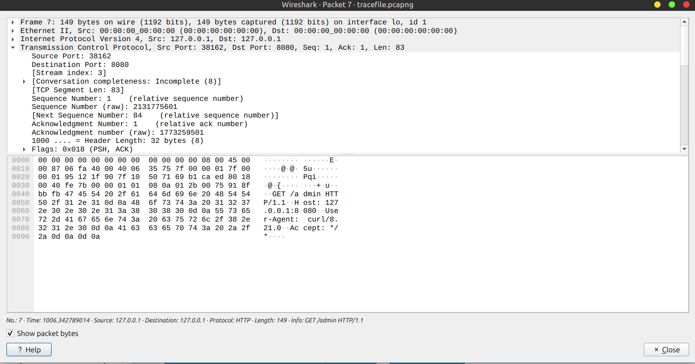
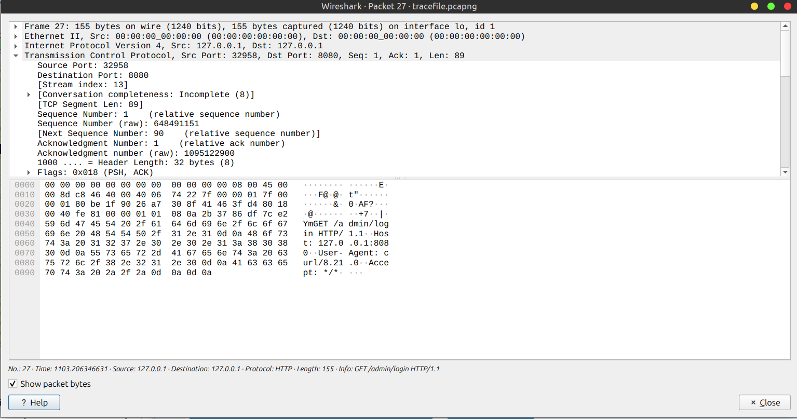
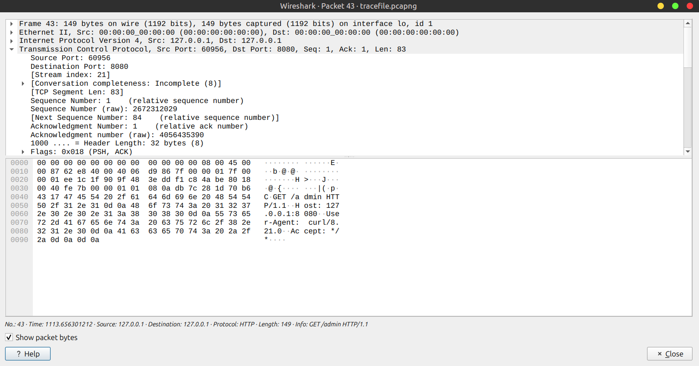

# Assignment - 1

- Name : Gaurang Tyagi
- Roll No : 16

---

# Task - 1 : Analyze a GET Request & Response

1. Identify one GET request and record its frame number.

> GET request



> Frame Number



2. Identify the corresponding HTTP response and record its frame number.

> HTTP response


> Frame Number

```
Frame Number : 8
```

3. What is the requested URI?

> Request URI



4. What is the HTTP version?

```
Http version : 1.1
```


5. What is the value of the Host field?

```
Host: 127.0.0.1:8080
```

6. What is the reported User-Agent?

```
User-Agent : curl/8.21.0
```

7. What HTTP response status code was returned?

```
Response Code : 404
```

8. What does the response status code indicate?

```
The server could not find the requested /admin resource.
```

9. What is the response Content-Type?

```
Content-Type : text/html
```

10. Does the response contain a response body?

```
yes
```

11. Identify three HTTP header fields and explain their purpose.

```
1. Host : Specifies the server (host and port) that the client wants to communicate with.
2. User-Agent : Identifies the client software making the HTTP request. Here, the client is curl version
3. Accept : Tells the server which response content types the client is willing to accept. */* means the client accepts any content type.
```

# Task 2 : Analyze a POST Request and Response

1. Identify a POST request and record its frame number.
```
Frame No : 3
```
2. Identify the corresponding response and record its frame number.
```
Frame Number : 4
```

3. What is the requested URI?
```
http://127.0.0.1:8080/login
```

4. What is the value of the Content-Type field?
```
application/x-www-form-urlencoded
```

5. Does the request contain a body?
```
yes
```

6. What information is contained in the request body?
```
The request body contains URL-encoded login credentials:
username=alice
password=Lab123
```
7. Identify the Content-Length field, if present.
```
Content-Length: 30
```

8. What response status code is returned?
```
HTTP/1.1 200 OK
```

9. What information is contained in the response?
```
The response contains an HTML document of 482 bytes. The captured data begins with <!DOCTYPE HTML>, indicating that the server returned an HTML page.
```

10. Which fields distinguish this POST request from a GET request?
```
1. HTTP method : for GET requests the HTTP method is GET whereas for POST request it is POST
2. Content-Length : POST request header has Content-Length property to specify  the size of payload/data

```

# Task 3: Analyze an HTTP Cookie

1. Identify a frame containing a cookie.


2. Record the frame number.
```
Frame Number : 5
```
3. What is the cookie value?
```
session_id=MCA3LAB
```

4. Is the cookie transmitted by the client or by the server?
```
It is being transmitted by the client
```
5. In which HTTP header is a client cookie normally transmitted?
```
Cookie header
```

# Task 5: Identify Enumeration and Probing Activity

## Task 5.1 :  Identify Resource Enumeration

1. Identify the frame number(s) that you consider indicators of resource enumeration.
```
Frame numbers : 7-25 & 27 are indicators of resource enumeration

```
2. Record the requested URI for each identified frame.
```
The requested URIs are:

/admin
/admin
/login
/config
/backup
/.env
/database
/phpmyadmin
/server-status
/uploads
/admin/login
```
3. Are multiple requests made within a short period of time?
```
yes
```

4. How do the response status codes support your interpretation?
```
The available HTTP responses return status code 304 Not Modified. However, these responses appear to correspond to normal resource requests (such as CSS/JavaScript) rather than the resource-enumeration requests. Therefore, the response status codes in the capture do not provide strong evidence for the enumeration activity. The enumeration interpretation is instead supported primarily by the rapid sequence of requests to different potentially sensitive URIs.
```

5. Identify the first and last frame belonging to the enumeration sequence.

> First Frame



> Last Frame



6. Explain why the identified sequence is more consistent with resource enumeration than
with ordinary browsing.

```
The sequence is more consistent with resource enumeration because the client sends numerous HTTP GET requests for different potentially sensitive or administrative URIs within a very short period. The requests target paths such as /admin, /config, /backup, /.env, /phpmyadmin, /server-status, and /uploads, which are not typical resources requested during ordinary browsing. The rapid and systematic nature of the requests suggests that the client is probing the server to discover available resources and endpoints.
```

## 5.2 : Identify Probing Activity

1. Identify the frame number(s) and timestamps that you consider indicators of probing.

|  Frame |         Timestamp | Request      |
| -----: | ----------------: | ------------ |
| **29** | `1113.6222397...` | `GET /admin` |
| **31** |     `1113.627...` | `GET /admin` |
| **33** | `1113.6328711...` | `GET /admin` |
| **35** |     `1113.637...` | `GET /admin` |
| **37** | `1113.6423331...` | `GET /admin` |
| **39** | `1113.6467627...` | `GET /admin` |
| **41** | `1113.6517831...` | `GET /admin` |
| **43** | `1113.6563012...` | `GET /admin` |

2. What endpoint is being tested?
```
The endpoint being repeatedly tested is: /admin
```

3. What characteristics distinguish the probing sequence from normal HTTP activity?
```
The sequence is distinguished by repeated requests to the same /admin endpoint at very short time intervals. The repetitive and rapid nature of the requests suggests automated probing rather than normal HTTP browsing activity.
```
4. Identify the first and last packet in the probing sequence and provide the frame numbers.

> First Frame


> Last Frame



# Task 6: Identify and Analyze a Suspicious-Looking Frame

1. Identify one suspicious-looking HTTP request and record the frame.
```
Request: GET /search?q=%27%20OR%20%271%27%3D%271 HTTP/1.1
```

2. Identify the query parameter.
```
The query parameter is: q
```

3. Identify the encoded value of the parameter.
```
encoded value of parameter : %27%20OR%20%271%27%3D%271
```
4. Determine which characters are URL encoded.

| Encoding | Character          |
| -------- | ------------------ |
| `%27`    | `'` (single quote) |
| `%20`    | space              |
| `%3D`    | `=`                |

5. Decode the encoded characters.
```
%27 → '
%20 → [space]
%3D → =
```
6. Write the complete decoded parameter value.
```
' OR '1'='1
```
7. What does the decoded value appear to represent?
```
It appears to represent a SQL injection payload, specifically a condition intended 
to always evaluate as true:
```
8. Why might this parameter be considered suspicious?
```
The value contains SQL syntax such as single quotes, OR, and an equality comparison. The expression '1'='1' is always true, which is a common pattern used when testing whether user input is being unsafely incorporated into an SQL query.
```