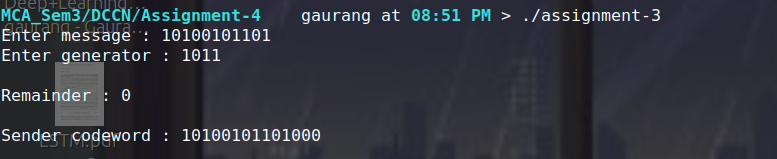
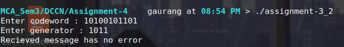
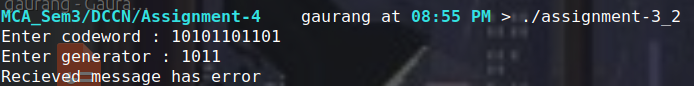

## Assignment 3

    Name : Gaurang Tyagi
    Roll no. : 16
    Course : MCA
    Subject : Data Communicatiosn and Computer Networks

### Programming Tasks

The following tasks require implementing CRC in a language of your choice (C, C++, Java, or Python are recommended). Submit source code along with sample output for each task.

#### Task 1: CRC Generator (Sender Side)

Write a program that:

1. Accepts a binary message string and a generator polynomial (as a bit string) from the user.
2. Appends r zero bits to the message, where r is one less than the length of the generator.
3. Performs modulo-2 (XOR-based) division to compute the CRC remainder.
4. Outputs the remainder and the final transmitted frame (message + CRC).

```c
#include <stdio.h>
#include <string.h>
#include <stdlib.h>

int bitsCount(long data) {
    int bits = 0;

    while (data > 0) {
        bits++;
        data>>=1;
    }

    return bits;
}

char* crc(char* message, char* generator) {
    long msg = strtol(message,NULL,2);
    long gen = strtol(generator,NULL,2);

    int msg_len = bitsCount(msg), gen_len = bitsCount(gen);

    if (msg_len < gen_len) {
        printf("Error : generator has to be less long then message\n");
        return "";
    }

    long rem = msg << (gen_len-1);
    int rem_len = msg_len + gen_len - 1;

    do {
        rem = rem ^ (gen << (rem_len - gen_len));
        rem_len = bitsCount(rem);
    } while(rem_len >= gen_len);

    printf("\nRemainder : %lb\n\n",rem);

    msg = (msg << (gen_len-1)) | rem;
    msg_len += (gen_len - 1);

    char* codeword = (char*)calloc(msg_len+1,sizeof(char));

    for(int i=msg_len-1; i>=0; i--) {
        codeword[i] = (msg&1)?'1':'0';
        msg >>= 1;
    }

    codeword[msg_len] = '\0';

    return codeword;
}

int main() {
    char* message = (char*)calloc(65,sizeof(char));
    char* generator = (char*)calloc(65,sizeof(char));

    printf("Enter message : ");
    scanf("%s",&message[0]);

    printf("Enter generator : ");
    scanf("%s",&generator[0]);

    char* codeword = crc(message,generator);

    printf("Sender codeword : %s\n",codeword);

    free(message);
    free(generator);

    return 0;
}
```



#### Task 2: CRC Checker (Receiver Side)

Write a program that:

1. Accepts a received bit string and the same generator polynomial used at the sender.
2. Divides the received string by the generator polynomial using modulo-2 division.
3. Reports whether the frame is error-free (remainder is all zeros) or corrupted (non-zero remainder).

```c
#include <stdio.h>
#include <string.h>
#include <stdlib.h>
#include <stdbool.h>

int bitsCount(long data) {
    int bits = 0;

    while (data > 0) {
        bits++;
        data>>=1;
    }

    return bits;
}

bool crc_check(char* codeword, char* generator) {
    long cdw = strtol(codeword,NULL,2);
    long gen = strtol(generator,NULL,2);

    int cdw_len = bitsCount(cdw), gen_len = bitsCount(gen);

    if (cdw_len < (2*gen_len)) {
        printf("Error : codeword has to be twice as long as generator\n");
        return "";
    }

    long rem = cdw;
    int rem_len = cdw_len;

    do {
        rem = rem ^ (gen << (rem_len - gen_len));
        rem_len = bitsCount(rem);
    } while(rem_len >= gen_len);

    return (rem == 0);
}

int main() {
    char* codeword = (char*)calloc(65,sizeof(char));
    char* generator = (char*)calloc(65,sizeof(char));

    printf("Enter codeword : ");
    scanf("%s",&codeword[0]);

    printf("Enter generator : ");
    scanf("%s",&generator[0]);

    bool correct = crc_check(codeword,generator);

    printf("Recieved message has %serror\n",correct?"no ":"");

    free(codeword);
    free(generator);

    return 0;
}
```

Test your program by

- passing an unmodified frame produced by Task 1, and



- manually flipping one or more bits before checking.


