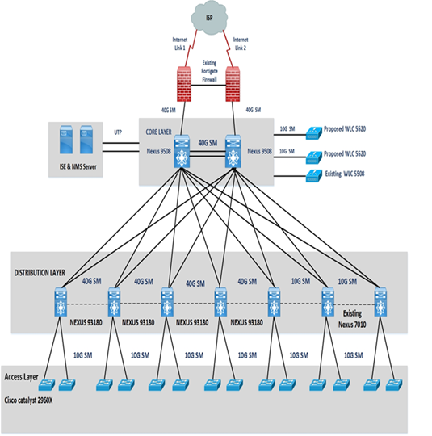
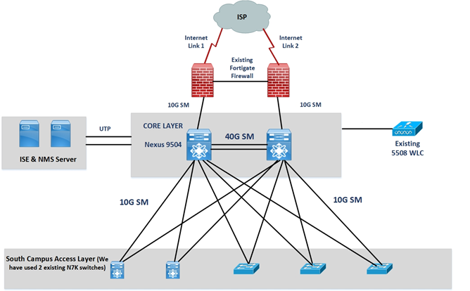

<h1 style="text-align:center">Campus Connect Project</h1>

```
DU is using a redundant hierarchical campus architecture where dual Nexus 9508 switches form the high-speed core, multiple Nexus 93180 and existing Nexus 7K switches provide distribution for seven locations, 10G single-mode fiber connects distribution to access switches, dual Internet links terminate on FortiGate firewalls, WLCs provide redundant wireless management, Cisco ISE provides AAA, and Cisco Prime provides centralized network management. South Campus uses dual Nexus 9504 core switches with 10G connections directly to the access layer, while existing Nexus 7K hardware is reused where appropriate.

```

# Proposed Network Architecture for University of Delhi

> North Campus



> South Campus




# Architecture highlights:

- The architecture follows cisco campus model
- DU internet link terminates on Fortigate firewall, which connects core switch Nexus 9508.
- Two Nexus 9508 in core layer for redundancy both are inter-connected with 40G fiber link.
- DU needs to connect seven different location with core Nexus 9508.
- Out of 7-distribution location, we have proposed five Nexus 93180 and for two we will use the existing Nexus 7K. Existing Nexus 7K has 10G uplink, it does not support 40 G hence will place these switches where users and traffic are less. This is decided as per customer feedback. In addition, customer already have SFP modules for Nexus 7K, we can use the existing modules.
- All the distribution switches are connected in ring with core.
- Seven different distribution sites will connect to their respective access switches with 10G Single mode Fiber.
- For Wi-Fi solution, we have proposed two WLC deployed in N+1 HA configuration. Connectivity between core and WLC will be on 10 G.
- Will place three WLC in north campus, 2 new and 1 existing and south is having one existing WLC, HA for south campus will be on North campus WLC.
- For AAA we have proposed Cisco ISE.
- For NMS we have proposed Cisco Prime Infrastructure
- For South Campus we have proposed two Nexus 9504 in core and will be directly connected to access layer on 10G and 2 existing nexus 7K will be used in south campus.
  DU is to remove all the stack modules from access switches also for SFP module on existing Nexus 7010.

# Notes
- Three layers
    - **Core Layer** : The core is the high-speed backbone.
    - **Distribution Layer** : The distribution layer connects the core to different locations/buildings.
    - **Access Layer** : The access layer is where actual users/devices connect.
- Cisco Nexus 9508 is the core switch
- Nexus 93180, Nexus 7010/7K switches are part of the Distribution Layer
- The distribution switches aggregate traffic coming from many access switches.
- The access switches are Cisco Catalyst 2960X.
- There are two core swtiches and links for redundancy.
- The FortiGate firewall sits between the Internet and the university's internal network.
- The firewall provides security functions such as:

    - Traffic filtering
    - Access control
    - Threat prevention
    - VPN functionality
    - Internet security policies

- The SFP converts the electrical/optical interface appropriately for the fiber connection.
- All distribution switches are connected in a ring with core.
- Single-mode fiber is commonly used for longer-distance/high-speed links.
- UTP = Unshielded Twisted Pair.
- Each distribution location connects to its access switches using 10G Single Mode Fiber.
- WLC = Wireless LAN Controller.
- A WLC centrally manages wireless access points.It can handle things such as:

    - SSIDs
    - Authentication
    - Wireless policies
    - AP management
    - Roaming
    - RF management
    - WLAN configuration

- N+1 HA (High Availablity) means they have enough controllers to handle the normal workload, plus one additional controller for redundancy.
- North Campus has 3 WLCs.
- South Campus has 1 WLC.
- WLCs connect to the core using 10G links.
- ISE = Identity Services Engine used for authentication,authorization and accounting (AAA).
- NMS = Network Management System.It provides a centrilized view for all the devices.