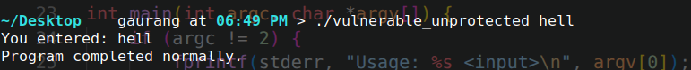
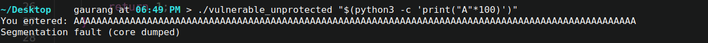
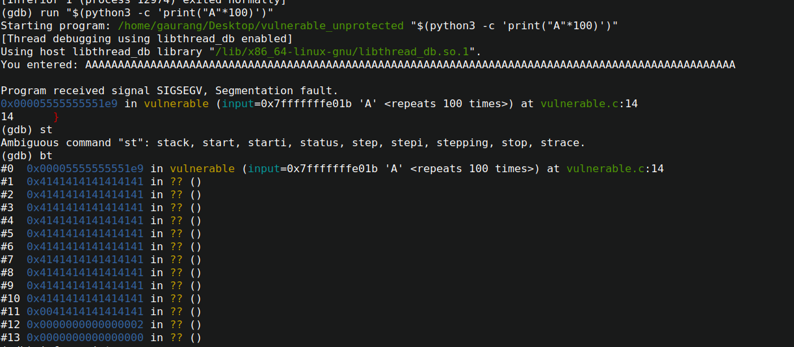
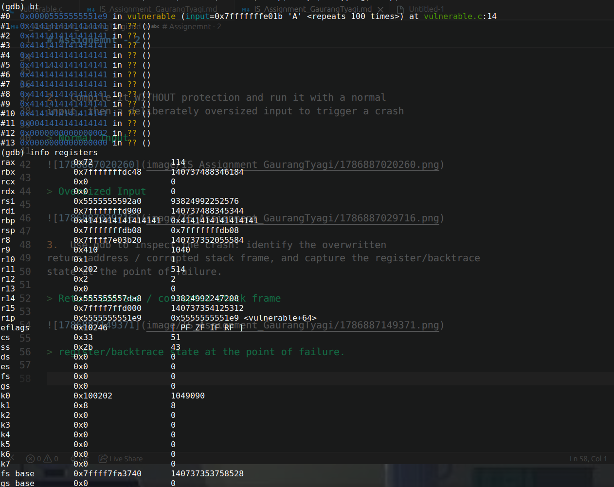
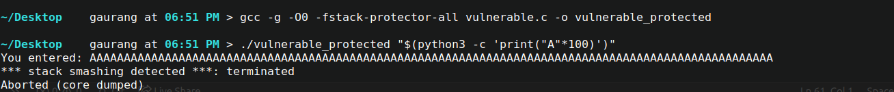

# Assignemnt - 2

1. Write a small C program with an intentionally unsafe
function (e.g., using gets() or strcpy() into a fixed-size stack buffer, with
no bounds checking).

> source code
```c
#include <stdio.h>
#include <string.h>

void vulnerable(const char *input) {
    char buffer[5];

    strcpy(buffer, input);

    printf("You entered: %s\n", buffer);
}

int main(int argc, char *argv[]) {
    if (argc != 2) {
        fprintf(stderr, "Usage: %s <input>\n", argv[0]);
        return 1;
    }

    vulnerable(argv[1]);
    printf("Program completed normally.\n");

    return 0;
}

```

2.  Compile it WITHOUT protection and run it with a normal
input, then a deliberately oversized input to trigger a crash

> Normal Input



> Oversized Input



3. Use gdb to inspect the crash: identify the overwritten
return address / corrupted stack frame, and capture the register/backtrace
state at the point of failure.

> Return address / corrupted stack frame



> register/backtrace state at the point of failure.



4. Recompile the SAME program WITH protections enabled. Repeat the oversized input and show that the program now terminates safely



