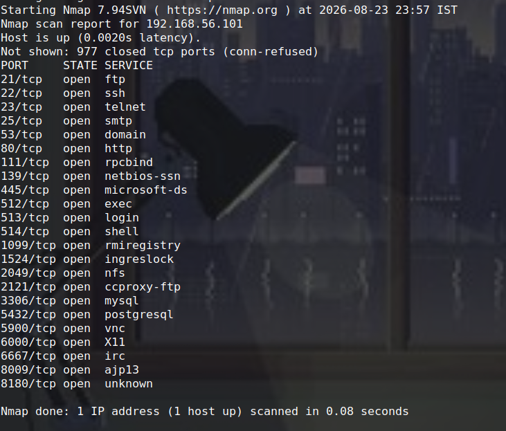
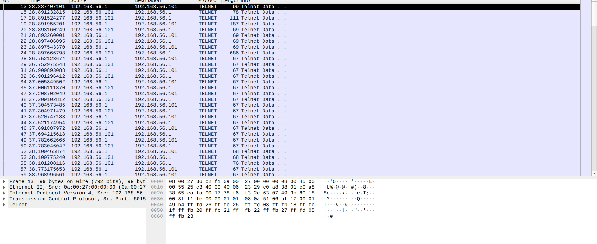
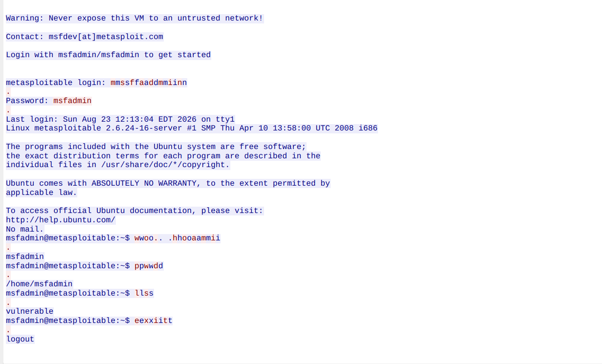
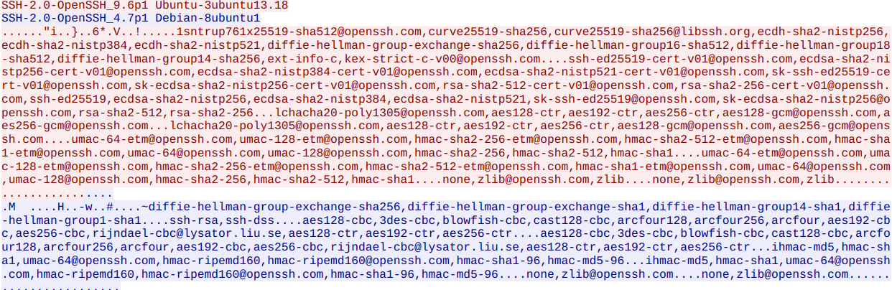

> Name : Gaurang Tyagi

> Roll No. : 16

# Network Security Assignment

## Part A — Network Scanning and Service Enumeration

### 1. Setup

| Component                    | Configuration       |
| ---------------------------- | ------------------- |
| Host OS                      | Linux Mint          |
| VirtualBox Host-only Network | `vboxnet0`        |
| Host-only Network            | `192.168.56.0/24` |
| Host IP                      | `192.168.56.1`    |
| Target                       | Metasploitable 2    |
| Target IP                    | `192.168.56.101`  |

The target VM was connected to the `vboxnet0` host-only network so that the security testing remained isolated from the normal network.

### 2. Basic Nmap Scan

Command used:

```bash
nmap 192.168.56.101
```



### 3. Service and OS Detection

Command used:

```bash
nmap -sV -A 192.168.56.101
```

> Output

```bash
Starting Nmap 7.94SVN ( https://nmap.org ) at 2026-08-23 23:26 IST
Nmap scan report for 192.168.56.101
Host is up (0.00053s latency).
Not shown: 977 closed tcp ports (conn-refused)
PORT     STATE SERVICE     VERSION
21/tcp   open  ftp         vsftpd 2.3.4
| ftp-syst: 
|   STAT: 
| FTP server status:
|      Connected to 192.168.56.1
|      Logged in as ftp
|      TYPE: ASCII
|      No session bandwidth limit
|      Session timeout in seconds is 300
|      Control connection is plain text
|      Data connections will be plain text
|      vsFTPd 2.3.4 - secure, fast, stable
|_End of status
|_ftp-anon: Anonymous FTP login allowed (FTP code 230)
22/tcp   open  ssh         OpenSSH 4.7p1 Debian 8ubuntu1 (protocol 2.0)
| ssh-hostkey: 
|   1024 60:0f:cf:e1:c0:5f:6a:74:d6:90:24:fa:c4:d5:6c:cd (DSA)
|_  2048 56:56:24:0f:21:1d:de:a7:2b:ae:61:b1:24:3d:e8:f3 (RSA)
23/tcp   open  telnet      Linux telnetd
25/tcp   open  smtp        Postfix smtpd
|_ssl-date: 2026-08-23T16:03:09+00:00; -1h54m37s from scanner time.
|_smtp-commands: metasploitable.localdomain, PIPELINING, SIZE 10240000, VRFY, ETRN, STARTTLS, ENHANCEDSTATUSCODES, 8BITMIME, DSN
| sslv2: 
|   SSLv2 supported
|   ciphers: 
|     SSL2_RC4_128_EXPORT40_WITH_MD5
|     SSL2_RC4_128_WITH_MD5
|     SSL2_RC2_128_CBC_WITH_MD5
|     SSL2_DES_192_EDE3_CBC_WITH_MD5
|     SSL2_DES_64_CBC_WITH_MD5
|_    SSL2_RC2_128_CBC_EXPORT40_WITH_MD5
53/tcp   open  domain      ISC BIND 9.4.2
| dns-nsid: 
|_  bind.version: 9.4.2
80/tcp   open  http        Apache httpd 2.2.8 ((Ubuntu) DAV/2)
|_http-server-header: Apache/2.2.8 (Ubuntu) DAV/2
|_http-title: Metasploitable2 - Linux
111/tcp  open  rpcbind     2 (RPC #100000)
| rpcinfo: 
|   program version    port/proto  service
|   100000  2            111/tcp   rpcbind
|   100000  2            111/udp   rpcbind
|   100003  2,3,4       2049/tcp   nfs
|   100003  2,3,4       2049/udp   nfs
|   100005  1,2,3      45553/tcp   mountd
|   100005  1,2,3      45757/udp   mountd
|   100021  1,3,4      52355/tcp   nlockmgr
|   100021  1,3,4      60192/udp   nlockmgr
|   100024  1          33306/tcp   status
|_  100024  1          49382/udp   status
139/tcp  open  netbios-ssn Samba smbd 3.X - 4.X (workgroup: WORKGROUP)
445/tcp  open  netbios-ssn Samba smbd 3.0.20-Debian (workgroup: WORKGROUP)
512/tcp  open  exec        netkit-rsh rexecd
513/tcp  open  login       OpenBSD or Solaris rlogind
514/tcp  open  shell       Netkit rshd
1099/tcp open  java-rmi    GNU Classpath grmiregistry
1524/tcp open  bindshell   Metasploitable root shell
2049/tcp open  nfs         2-4 (RPC #100003)
2121/tcp open  ftp         ProFTPD 1.3.1
3306/tcp open  mysql       MySQL 5.0.51a-3ubuntu5
| mysql-info: 
|   Protocol: 10
|   Version: 5.0.51a-3ubuntu5
|   Thread ID: 21
|   Capabilities flags: 43564
|   Some Capabilities: Speaks41ProtocolNew, Support41Auth, SupportsCompression, LongColumnFlag, ConnectWithDatabase, SwitchToSSLAfterHandshake, SupportsTransactions
|   Status: Autocommit
|_  Salt: vQp`o/;ysT,zG2c|iu13
5432/tcp open  postgresql  PostgreSQL DB 8.3.0 - 8.3.7
|_ssl-date: 2026-08-23T16:03:09+00:00; -1h54m37s from scanner time.
5900/tcp open  vnc         VNC (protocol 3.3)
| vnc-info: 
|   Protocol version: 3.3
|   Security types: 
|_    VNC Authentication (2)
6000/tcp open  X11         (access denied)
6667/tcp open  irc         UnrealIRCd
8009/tcp open  ajp13       Apache Jserv (Protocol v1.3)
|_ajp-methods: Failed to get a valid response for the OPTION request
8180/tcp open  http        Apache Tomcat/Coyote JSP engine 1.1
|_http-title: Apache Tomcat/5.5
|_http-server-header: Apache-Coyote/1.1
|_http-favicon: Apache Tomcat
Service Info: Hosts:  metasploitable.localdomain, irc.Metasploitable.LAN; OSs: Unix, Linux; CPE: cpe:/o:linux:linux_kernel

Host script results:
| smb-security-mode: 
|   account_used: guest
|   authentication_level: user
|   challenge_response: supported
|_  message_signing: disabled (dangerous, but default)
|_nbstat: NetBIOS name: METASPLOITABLE, NetBIOS user: <unknown>, NetBIOS MAC: <unknown> (unknown)
| smb-os-discovery: 
|   OS: Unix (Samba 3.0.20-Debian)
|   Computer name: metasploitable
|   NetBIOS computer name: 
|   Domain name: localdomain
|   FQDN: metasploitable.localdomain
|_  System time: 2026-08-23T12:02:33-04:00
|_clock-skew: mean: -54m37s, deviation: 2h00m00s, median: -1h54m37s
|_smb2-time: Protocol negotiation failed (SMB2)

Service detection performed. Please report any incorrect results at https://nmap.org/submit/ .
Nmap done: 1 IP address (1 host up) scanned in 52.18 seconds
```

### 4. Identified Open Services


The following three services were selected from the Nmap scan:

| Port   | Service | Version            | Why an intruder might target it                                                                                            |
| ------ | ------- | ------------------ | -------------------------------------------------------------------------------------------------------------------------- |
| 21/tcp | FTP     | vsftpd 2.3.4       | Anonymous FTP login is enabled, which may allow unauthenticated access to files or other resources.                        |
| 23/tcp | Telnet  | Linux telnetd      | Telnet does not encrypt the session, so credentials and commands can potentially be captured from network traffic.         |
| 80/tcp | HTTP    | Apache httpd 2.2.8 | An exposed web server provides an attack surface through web applications, outdated software, or configuration weaknesses. |

---

# Part B — Plaintext vs Encrypted Traffic

## 1. Wireshark Capture Setup

Wireshark was used to capture traffic on the VirtualBox host-only interface:

```text
vboxnet0
```

The target was:

```text
192.168.56.101
```



---

## 2. Unencrypted Protocol — Telnet

A Telnet connection was established from the Linux host to the Metasploitable 2 target.

Command used:

```bash
telnet 192.168.56.101
```

After logging in, the following  commands were executed:

```text
whoami
pwd
ls
```

### Plaintext Capture



### Observation

The Telnet TCP stream contains readable session information, including the username, password, and commands. This occurs because Telnet transmits its application data without encryption.

---

## 3. Encrypted Protocol — SSH

The same type of interaction was repeated using SSH.

Command used:

```bash
ssh -oHostKeyAlgorithms=+ssh-rsa msfadmin@192.168.56.101
```

The SSH session was used to execute:

```text
whoami
pwd
ls
```

### Encrypted Capture



### Observation

The SSH TCP stream does not reveal the username/password or commands as readable application data. The capture contains SSH protocol negotiation information followed by encrypted session traffic.

---

# 4. Conclusion

First, Nmap can identify exposed network services and provide information about the services and versions running on a target system. The Metasploitable 2 scan revealed several open and legacy services, including FTP, Telnet, HTTP, SSH, MySQL, and others.

Second, Wireshark can be used to inspect network traffic. The Telnet experiment showed that credentials and commands can appear in plaintext because the protocol does not encrypt the session. Repeating the interaction over SSH demonstrated that the corresponding session data is encrypted and therefore not directly readable from the captured TCP stream.

The results illustrate why unnecessary or insecure services should not be exposed and why encrypted protocols such as SSH should be preferred for remote administration.
