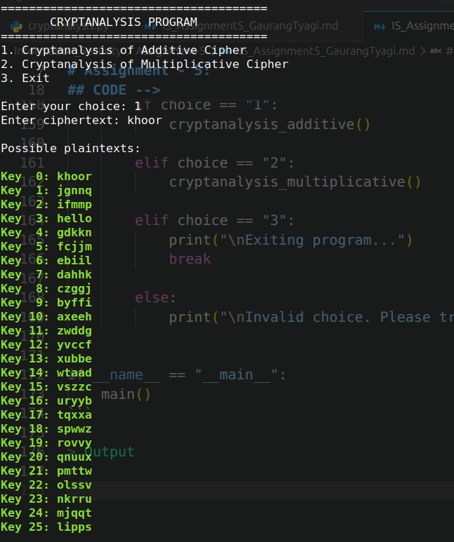
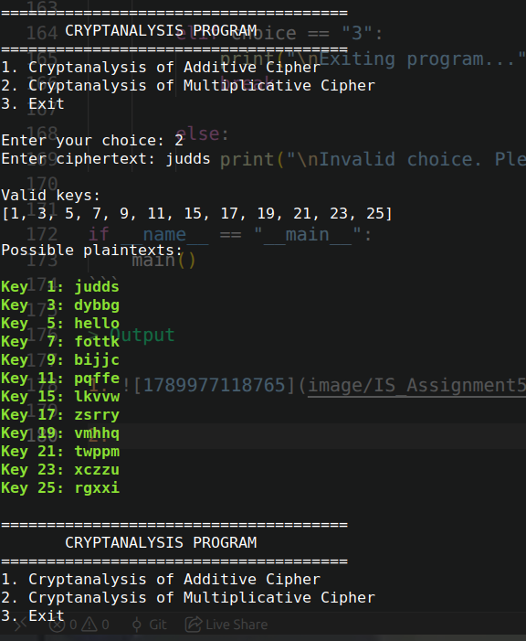

> Name : Gaurang Tyagi

> Roll Number : 16

---

# Assignment - 5:

```text
Implement these 2 practicals in Python (or any suitable programming language) in a single program, and attach screenshots showing the source code and the corresponding output for each practical:

1. Cryptanalysis of the Additive Cipher


2. Cryptanalysis of the Multiplicative Cipher
```

> CODE -->

```python

import math


def decrypt_additive(ciphertext, key):
    """uses the key k to decypher ciphertext

    Args:
        ciphertext (str): encrypted text
        key (int): key (between 1-26) used to encrypt input text

    Returns:
        str: return plain text
    """
    plaintext = ""

    for ch in ciphertext:
        if ch.isalpha():
            if ch.isupper():
                value = (ord(ch) - ord('A') - key) % 26
                plaintext += chr(value + ord('A'))
            else:
                value = (ord(ch) - ord('a') - key) % 26
                plaintext += chr(value + ord('a'))
        else:
            plaintext += ch

    return plaintext


def cryptanalysis_additive():
    """Cryptanalysis of Additive Cypher
    """

    ciphertext = input("Enter ciphertext: ")

    print("\nPossible plaintexts:\n")

    for key in range(26):
        plaintext = decrypt_additive(ciphertext, key)
        print(f"\033[1;32mKey {key:2}: {plaintext}\033[0m")
        


# ---------------------------------------------------------
# MULTIPLICATIVE CIPHER
# ---------------------------------------------------------

def mod_inverse(key, modulus=26):
    """gives the modulus inverse of key

    Args:
        key (int): _description_
        modulus (int, optional):  Defaults to 26.

    Returns:
        int: modulus inverse of key k with modulus 26
    """
    for i in range(1, modulus):
        if (key * i) % modulus == 1:
            return i

    return None


def decrypt_multiplicative(ciphertext, key):
    """uses the key  to decypher ciphertext

    Args:
        ciphertext (str): encrypted text obtained from multiplicative cypher
        key (int): key (gcd(key,26) should be 1) used to obtain ciphertext

    Returns:
        str: plain text
    """
    inverse = mod_inverse(key)

    plaintext = ""

    for ch in ciphertext:
        if ch.isalpha():
            if ch.isupper():
                value = ((ord(ch) - ord('A')) * inverse) % 26
                plaintext += chr(value + ord('A'))
            else:
                value = ((ord(ch) - ord('a')) * inverse) % 26
                plaintext += chr(value + ord('a'))
        else:
            plaintext += ch

    return plaintext


def cryptanalysis_multiplicative():
    """Cryptanalysis of Multiplicative Cypher
    """

    ciphertext = input("Enter ciphertext: ")

    print("\nValid keys:")
    
    valid_keys = []

    for key in range(26):
        if math.gcd(key, 26) == 1:
            valid_keys.append(key)

    print(valid_keys)

    print("\nPossible plaintexts:\n")

    for key in valid_keys:
        plaintext = decrypt_multiplicative(ciphertext, key)
        
        print(f"\033[1;32mKey {key:2}: {plaintext}\033[0m")
       


# ---------------------------------------------------------
# MAIN MENU
# ---------------------------------------------------------

def main():

    while True:

        print("\n======================================")
        print("       CRYPTANALYSIS PROGRAM")
        print("======================================")

        print("1. Cryptanalysis of Additive Cipher")
        print("2. Cryptanalysis of Multiplicative Cipher")
        print("3. Exit")

        choice = input("\nEnter your choice: ")

        if choice == "1":
            cryptanalysis_additive()

        elif choice == "2":
            cryptanalysis_multiplicative()

        elif choice == "3":
            print("\nExiting program...")
            break

        else:
            print("\nInvalid choice. Please try again.")


if __name__ == "__main__":
    main()
```

> Output

1. 

2. 