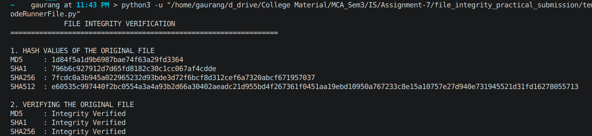
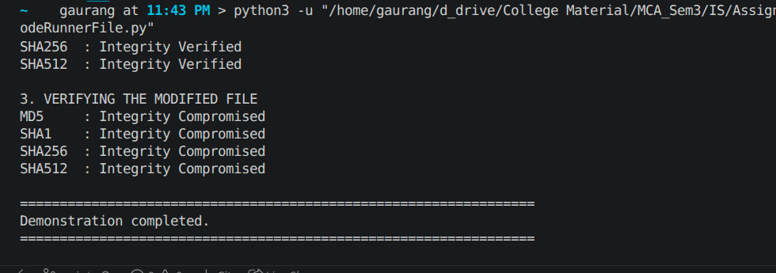

# Assignment 7

        Name : Gaurang Tyagi
        Roll : 16

```
Implement this practical in Python (or any suitable programming language), and attach screenshots showing the source code and the corresponding output :

Verification of file integrity and displaying "Integrity Verified" or "Integrity Compromised" Based on various hashing algorithms.

```

**CODE**

```python
import hashlib
import hmac
from pathlib import Path

# Hash algorithms supported by Python's hashlib module.
HASH_ALGORITHMS = ("md5", "sha1", "sha256", "sha512")


def calculate_hash(file_path, algorithm):
    """Return the hexadecimal hash digest of a file."""
    if algorithm not in HASH_ALGORITHMS:
        raise ValueError(f"Unsupported algorithm: {algorithm}")

    digest = hashlib.new(algorithm)

    # Read in chunks so large files do not need to fit into memory.
    with open(file_path, "rb") as file:
        for chunk in iter(lambda: file.read(4096), b""):
            digest.update(chunk)

    return digest.hexdigest()


def generate_hashes(file_path):
    """Calculate hashes of a file using all supported algorithms."""
    return {
        algorithm: calculate_hash(file_path, algorithm)
        for algorithm in HASH_ALGORITHMS
    }


def verify_integrity(file_path, expected_hash, algorithm):
    """
    Compare the current file hash with a previously saved hash.
    Returns True when they match; otherwise returns False.
    """
    current_hash = calculate_hash(file_path, algorithm)
    return hmac.compare_digest(current_hash.lower(), expected_hash.lower())


def run_demonstration():
    """Demonstrate verification before and after changing a file."""
    sample_file = Path("sample_document.txt")
    sample_file.write_text(
        "This is the original file. Its contents have not been changed.",
        encoding="utf-8"
    )

    print("=" * 65)
    print("             FILE INTEGRITY VERIFICATION")
    print("=" * 65)

    print("\n1. HASH VALUES OF THE ORIGINAL FILE")
    original_hashes = generate_hashes(sample_file)
    for algorithm, digest in original_hashes.items():
        print(f"{algorithm.upper():8}: {digest}")

    print("\n2. VERIFYING THE ORIGINAL FILE")
    for algorithm, expected_hash in original_hashes.items():
        result = verify_integrity(sample_file, expected_hash, algorithm)
        status = "Integrity Verified" if result else "Integrity Compromised"
        print(f"{algorithm.upper():8}: {status}")

    # Modify the file to simulate unauthorized or accidental changes.
    with sample_file.open("a", encoding="utf-8") as file:
        file.write("\nThis line was added after the original hash was recorded.")

    print("\n3. VERIFYING THE MODIFIED FILE")
    for algorithm, expected_hash in original_hashes.items():
        result = verify_integrity(sample_file, expected_hash, algorithm)
        status = "Integrity Verified" if result else "Integrity Compromised"
        print(f"{algorithm.upper():8}: {status}")

    print("\n" + "=" * 65)
    print("Demonstration completed.")
    print("=" * 65)


if __name__ == "__main__":
    run_demonstration()

```
**Sample Document**

```docx
This is the original file. Its contents have not been changed.
This line was added after the original hash was recorded.
```
**OUTPUT**




