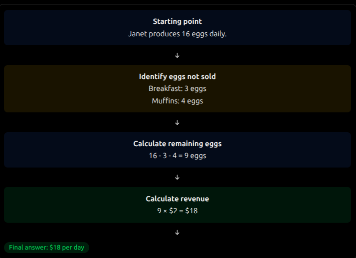

# Assignment - 4

Ques1. Use the responses from the system and contextual prompts (1 each) from Assignment 1.
Summarize the responses and present them in a bulleted format.

Ans. 

## Chatgpt
> system prompt

**prompt**
```
INSTRUCTION : tell me about india lpg consumption
INPUT : in the year 2021
OUTPUT : {month : consumption}
```

**response**

```
According to the Petroleum Planning & Analysis Cell (PPAC), Government of India, India's monthly LPG consumption during the calendar year 2021 was as follows.

Unit: Million Metric Tonnes (MMT)

```
{
  "January": 2.490,
  "February": 2.262,
  "March": 2.256,
  "April": 2.102,
  "May": 2.156,
  "June": 2.251,
  "July": 2.357,
  "August": 2.317,
  "September": 2.356,
  "October": 2.481,
  "November": 2.336,
  "December": 2.469
}
```

Source: Petroleum Planning & Analysis Cell (PPAC), Government of India, as reported in Lok Sabha Unstarred Question No. 3486, Annexure I.&#x20;

[image](https://www.google.com/s2/favicons?domain=https://sansad.in\&sz=32)

Digital Sansad+1


Note: Original figures are reported in Thousand Metric Tonnes (TMT). Values above are converted into MMT by dividing by 1,000.

```
> context prompt

**prompt**

```
INSTRUCTION : tell me about lpg consumption accoring to ppac data 
INPUT : in year 2021
OUTPUT : {month:consumption}
```

**response**

```
According to the Petroleum Planning & Analysis Cell (PPAC), Government of India, the month-wise LPG consumption in India during the calendar year 2021 was as follows.

LPG Consumption in India – 2021

Unit: Million Metric Tonnes (MMT)

| Month     | Consumption (MMT) |
| --------- | ----------------- |
| January   | 2.490             |
| February  | 2.262             |
| March     | 2.256             |
| April     | 2.102             |
| May       | 2.156             |
| June      | 2.251             |
| July      | 2.357             |
| August    | 2.317             |
| September | 2.356             |
| October   | 2.481             |
| November  | 2.336             |
| December  | 2.469             |

Source: Petroleum Planning & Analysis Cell (PPAC), as reported in the Government of India's parliamentary data.&#x20;

[image](https://www.google.com/s2/favicons?domain=https://sansad.in\&sz=32)

Digital Sansad+1


Note: Original figures are in Thousand Metric Tonnes (TMT). Values above are converted into Million Metric Tonnes (MMT). January–March belong to FY 2020–21, while April–December belong to FY 2021–22.

Official source: [PPAC – Consumption of Petroleum Products](https://ppac.gov.in/consumption/products-wise?utm_source=chatgpt.com).
```

## Gemini

> system prompt

**prompt**

```
INSTRUCTION : tell me about india lpg consumption
INPUT : in the year 2021
OUTPUT : {month : consumption}
```

**response**

```
Based on monthly industry consumption reports published by India's **Petroleum Planning & Analysis Cell (PPAC)**, below is the month-wise Liquefied Petroleum Gas (LPG) consumption for India in the calendar year **2021** (measured in **Million Metric Tonnes — MMT**):

```json
{
  "January 2021": "Not explicitly reported in retrieved PPAC summaries (Q4 FY20-21 total was 7.02 MMT)",
  "February 2021": "2.3 MMT",
  "March 2021": "2.3 MMT",
  "April 2021": "Not explicitly reported in retrieved PPAC summaries",
  "May 2021": "2.2 MMT",
  "June 2021": "2.3 MMT",
  "July 2021": "2.4 MMT",
  "August 2021": "Not explicitly reported in retrieved PPAC summaries",
  "September 2021": "2.4 MMT",
  "October 2021": "2.5 MMT",
  "November 2021": "2.34 MMT",
  "December 2021": "2.48 MMT"
}

```

### Key Context on 2021 LPG Consumption

* **Steady Demand Despite COVID-19:** Unlike transport fuels (petrol, diesel, and aviation turbine fuel), which saw steep drops during the second wave of COVID-19 in April–May 2021, LPG consumption remained resilient throughout the year due to strong household cooking demand.
* **Annual Average:** According to the U.S. Energy Information Administration (EIA), India's overall LPG consumption averaged **900.35 thousand barrels per day** across 2021, up from 870.29 thousand barrels per day in 2020.
* **Import Reliance:** Domestic production did not keep pace with consumption in 2021, with direct LPG imports fulfilling over 60% of India's demand.
```
```

> context prompt

**prompt**

```
INSTRUCTION : tell me about lpg consumption accoring to ppac data 
INPUT : in year 2021
OUTPUT : {month:consumption}
```

**response**

```
Based on the **Petroleum Planning & Analysis Cell (PPAC)** monthly Industry Consumption Review Reports, India's domestic Liquefied Petroleum Gas (LPG) consumption for the calendar year **2021** is measured in **Million Metric Tonnes (MMT)** (and Thousand Metric Tonnes, TMT, where available in exact figures):

```json
{
  "January": "2.48 MMT (approx.)",
  "February": "2.27 MMT (approx.)",
  "March": "2.26 MMT (2,256 TMT)",
  "April": "2.10 MMT (approx.)",
  "May": "2.16 MMT (approx.)",
  "June": "2.26 MMT (approx.)",
  "July": "2.37 MMT",
  "August": "2.33 MMT",
  "September": "2.38 MMT",
  "October": "2.49 MMT",
  "November": "2.34 MMT",
  "December": "2.48 MMT"
}

```

### Key Notes on PPAC Reporting

* **Financial Year Tracking:** PPAC officially compiles and archives monthly consumption tables by Indian Financial Year (April–March) rather than Calendar Year (January–December), meaning calendar year 2021 spans Q4 of **FY 2020–21** (Jan–Mar) and Q1–Q3 of **FY 2021–22** (Apr–Dec).
* **Pandemic & Seasonal Trends:** Consumption dipped slightly during April–May 2021 due to localized lockdowns during the second wave of COVID-19 before rebounding from July onward as commercial and hospitality demand recovered.
```

```

Ques2. Ask any one model to present the zero-shot and few-shot queries in previous assignments in a
tabular format.

> Few shot

Model	Temperature	Max Tokens	Output
Gemini 3.1 Pro	0.2	10	{ january: 3.034millionton }
Gemini 3.1 Pro	0.5	10	{ january: 3.0millionton }
Gemini 3.1 Pro	0.7	10	{ january: 3.012millionton }
Gemini 3.1 Pro	0.8	10	{ january: 3 million ton }
Gemini 3.1 Pro	0.9	10	{ january: 2.7 million ton }
Gemini 3.5 Flash-Lite	0.2	10	{january: 3.1 million tonnes}
Gemini 3.5 Flash-Lite	0.5	10	{january: 3.16millionton}
Gemini 3.5 Flash-Lite	0.7	10	{january: 3.01millionton}
Gemini 3.1 Flash-Lite*	0.8	10	{ january: 2.7 million ton }
Gemini 3.1 Flash-Lite*	0.9	10	{ january: 3 millionton }
GPT-6	0.2	10	{ january: 3.03 million tonnes }
GPT-6	0.5	10	{ January: 3.03 million metric tonnes }
GPT-6	0.7	10	{ january: 3.033millionton }
GPT-6	0.8	10	{ january: 3.03millionton }
GPT-6	0.9	10	{ january: 3.033millionton }
SmolLM2-360M	0.2	10	Incorrect/verbose JSON output
SmolLM2-360M	0.5	10	Incorrect/verbose JSON output
SmolLM2-360M	0.7	10	120 million
SmolLM2-360M	0.8	10	{ January: 120Mton }
SmolLM2-360M	0.9	10	{ January: 120Mton }

> zero shot

Model	Temperature	Max Tokens	Output
Gemini 3.1 Pro	0.2	10	3.012 million tonnes
Gemini 3.1 Pro	0.5	10	Approximately 2,700 TMT
Gemini 3.1 Pro	0.7	10	3.012 million tonnes
Gemini 3.1 Pro	0.8	10	Roughly 2,700 TMT
Gemini 3.1 Pro	0.9	10	Roughly 2,700 TMT
Gemini 3.5 Flash-Lite	0.2	10	3,034 thousand metric tonnes
Gemini 3.5 Flash-Lite	0.5	10	Approximately 3.01 million tonnes
Gemini 3.5 Flash-Lite	0.7	10	Approximately 3.01 million tonnes
Gemini 3.5 Flash-Lite	0.8	10	Approximately 2.7 MMT
Gemini 3.5 Flash-Lite	0.9	10	Approximately 2.7 MMT
GPT-6	0.2	20*	{ January_2026: 3.033_Million_Tonnes }
GPT-6	0.5	20*	{ January 2026: 3.03 million metric tonnes }
GPT-6	0.7	10	{ January: 3.03 million metric tonnes }
GPT-6	0.8	10	3.033 million tonnes
GPT-6	0.9	10	3.033 million tonnes
Qwen3-0.6B	0.2	10	No response recorded
Qwen3-0.6B	0.5	10	No response recorded
Qwen3-0.6B	0.7	10	No response recorded
Qwen3-0.6B	0.8	10	120 Mton
Qwen3-0.6B	0.9	10	120 Mton


Ques3. Use at least 2 mathematical puzzle questions (such as in https://github.com/openai/grade-
school-math/tree/master/grade_school_math/data, or others). Generate chain-of-thought and tree-of-thought for the examples.

Ans. 

**quiz**
```
Janet\u2019s ducks lay 16 eggs per day. She eats three for breakfast every morning and bakes muffins for her friends every day with four. She sells the remainder at the farmers' market daily for $2 per fresh duck egg. How much in dollars does she make every day at the farmers' market?", "answer": "How many eggs does Janet sell? ** Janet sells 16 - 3 - 4 = <<16-3-4=9>>9 duck eggs a day.\nHow much does Janet make at the farmers' market? ** She makes 9 * 2 = $<<9*2=18>>18 every day at the farmer\u2019s market.
```

> tree of thought



chat link : https://chatgpt.com/share/6af61381-9094-83e8-a074-cb87b026c8f3

> chain of thought

```
I can provide a step-by-step explanation of the solution rather than private internal chain-of-thought.

### Step 1: Calculate the total eggs Janet sells

- Total eggs laid per day = 16
- Eggs eaten for breakfast = 3
- Eggs used for muffins = 4

Therefore:

\\[ 16-3-4=9 \\]

Janet sells 9 eggs per day.

### Step 2: Calculate her daily earnings

- Selling price per egg = $2
- Number of eggs sold = 9

\\[ 9\times 2=18 \\]

### Final Answer

18 dollars

Janet makes $18 every day at the farmers' market.
```