# 1 Proposed Methods

## 1.1 Dataset Description

The dataset used in this study represents the annual petroleum production of India over multiple financial years. It provides historical production figures across different categories of petroleum-producing organizations, allowing an analysis of the overall production trends and patterns in the country.

The dataset consists of approximately 26 annual observations, covering the period from 1998–99 to 2023–24. The observations are recorded on a financial-year basis, making the dataset suitable for time-series analysis and forecasting.

The dataset contains the following major attributes:

| Attribute      | Description                                                                  |
| -------------- | ---------------------------------------------------------------------------- |
| Financial Year | Represents the financial year corresponding to the recorded production.      |
| ONGC           | Petroleum production contributed by Oil and Natural Gas Corporation.         |
| OIL            | Petroleum production contributed by Oil India Limited.                       |
| PSU Total      | Combined production contribution from public sector undertakings.            |
| JVC/Private    | Production contribution from joint venture and private sector organizations. |
| Total          | Overall petroleum production in India across the included categories.        |

For this study, the Total column is selected as the target variable for forecasting. The remaining production categories provide a breakdown of the contributions made by different sectors to India's overall petroleum production.

The historical observations are arranged chronologically to preserve the temporal order of the data. This is particularly important in time-series analysis, where past observations are used to understand underlying patterns and predict future values.

The primary objective of using this dataset is to study the historical behaviour of Indian petroleum production and evaluate the effectiveness of different time-series forecasting techniques in predicting future production levels.

## 1.2 Exploratory Data Analysis

Exploratory Data Analysis (EDA) was performed to understand the underlying characteristics, distribution, and temporal behaviour of the Indian petroleum production dataset. Various statistical and visualization techniques were used to identify long-term trends, fluctuations, sector-wise contributions, potential outliers, and autocorrelation patterns.

The analysis primarily focuses on the Total production variable.

### 1.2.1 Overall Yearly Petroleum Production Trend

Petroleum production in India across the financial years from 1998–99 to 2023–24.

**Figure 1.2.1: Overall yearly production**

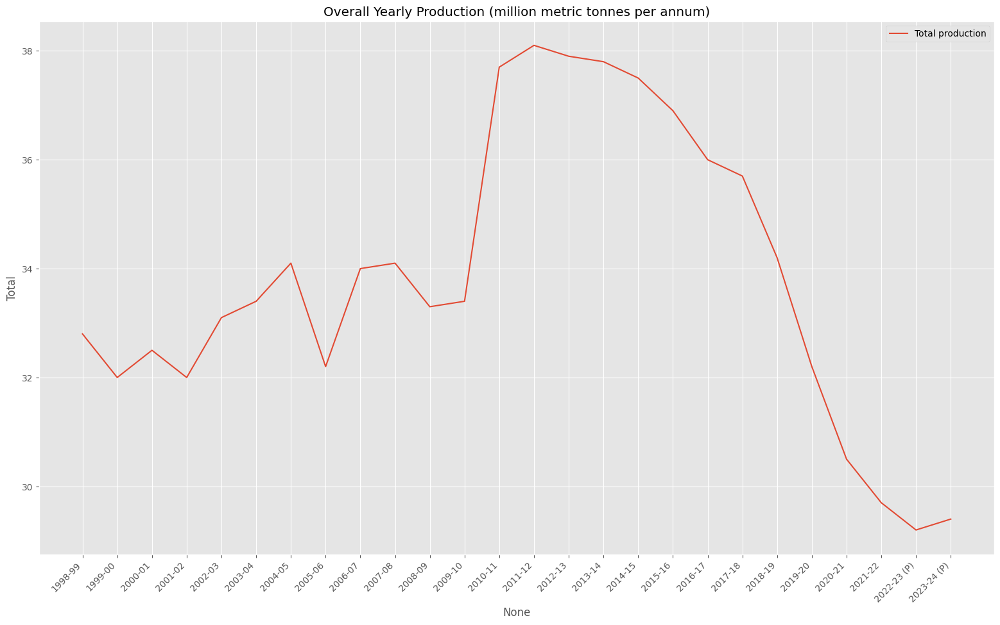Historical and Forecasted Petroleum Production using ARIMA(1,1,1)

> This reveals the following observations:

- During the initial period (1998–99 to 2009–10), total petroleum production fluctuated within a relatively narrow range of approximately 32–34 MMT.
- A significant increase in production can be observed during 2010–11, when production rose sharply to approximately 37.7 MMT.
- Production reached its highest level of approximately 38.1 MMT during 2011–12.
- Following this peak, production experienced a gradual decline, particularly after 2014–15.
- A more noticeable decline occurred between 2018–19 and 2022–23, with production falling to approximately 29.2 MMT.
- A slight recovery is visible in 2023–24, although production remains significantly below its historical peak.

The dataset exhibits distinct phases of production behaviour, including relatively stable fluctuations during the initial years, a sharp increase around 2010–11, and a prolonged declining trend in the subsequent years. This indicates the presence of a changing long-term trend rather than a constant production level.

### 1.2.2 Sector-wise Petroleum Production Analysis

Contributions of three major production categories: ONGC, Oil India Limited (OIL), and Joint Ventures/Private sector organizations.

**Figure 1.2.2: Overall yearly production**

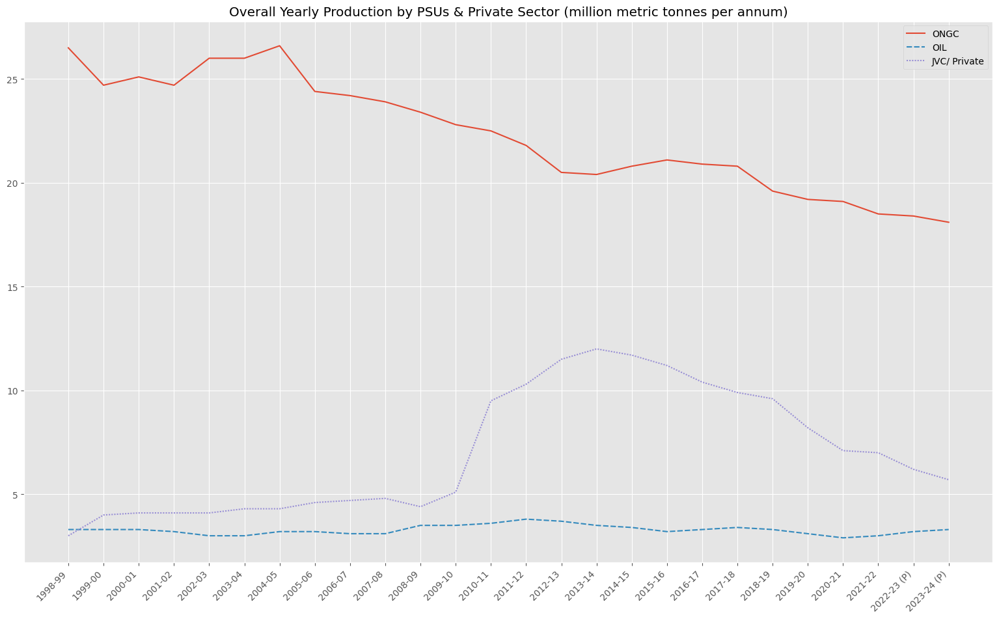

> The following observations were identified:

**ONGC**: ONGC has historically been the largest contributor to domestic petroleum production. However, its production shows a gradual declining trend, decreasing from approximately 26.5 MMT in the initial period to around 18 MMT in 2023–24.

**OIL**: Production from Oil India Limited remains relatively stable throughout the observation period, generally fluctuating between approximately 3 and 4 MMT.

**JVC/Private Sector**: The contribution from joint ventures and private sector organizations increased considerably around 2010–11. It reached a peak of approximately 12 MMT around 2013–14, followed by a gradual decline in subsequent years.

The sector-wise analysis indicates that the overall production pattern is influenced by changes in the contributions of individual production categories. In particular, the declining contribution from ONGC and the fluctuations in private sector production are important characteristics of the dataset.

### 1.2.3 Combined Production Contribution Analysis

A stacked area chart of the combined production contribution of public sector undertakings (PSUs) and the JVC/Private sector over the observation period.

**Figure 1.2.3: Petroleum production over time**

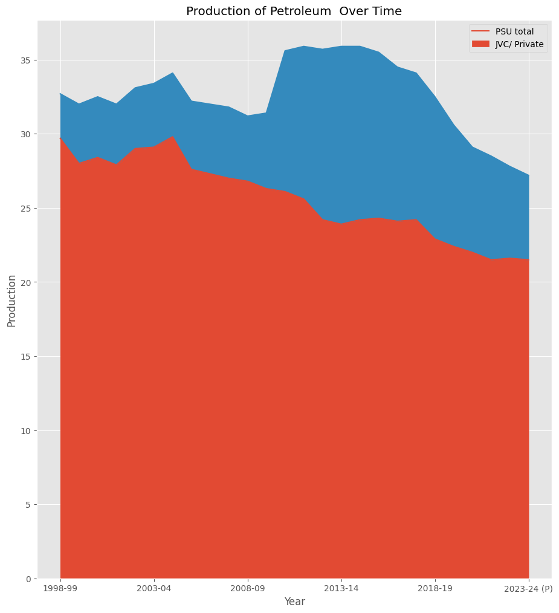

> The visualization highlights the following patterns:

- Public sector undertakings account for a substantial portion of India's petroleum production throughout the study period.
- The contribution from the private sector increases considerably around 2010–11, contributing to the rise in overall production.
- Following the peak period, both public and private sector contributions exhibit declining patterns.
- The combined production level decreases considerably towards the end of the observation period.

This gives an understanding of how different production sectors contribute to the overall production trend and highlights the changing composition of domestic petroleum production over time.

### 1.2.4 Year-over-Year Percentage Change Analysis

To understand the annual fluctuations in petroleum production, the year-over-year percentage change was calculated and visualized using a bar chart.

**Figure 1.2.4: Year over year change in petroleum production**

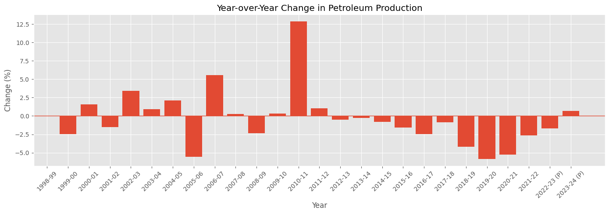

The percentage change was calculated using:

$$
\text{YoY Change} t =
\frac{Y_t-Y{t-1}}{Y_{t-1}}\times100
$$

Where:
The following observations were identified:

Production experienced both positive and negative annual growth during the initial years.

The most significant positive growth occurred around 2010–11, with an increase of approximately 12.8%.

After 2011–12, the dataset shows predominantly negative year-over-year growth.

The period between 2018–19 and 2020–21 experienced particularly noticeable negative changes.

Towards the end of the observation period, the annual decline becomes smaller, followed by a slight positive change in 2023–24 (provisional).

$(Y_t)$ represents petroleum production in the current year.

$(Y_{t-1})$ represents petroleum production in the previous year.

> The following observations were identified:

- Production experienced both positive and negative annual growth during the initial years.
- The most significant positive growth occurred around 2010–11, with an increase of approximately 12.8%.
- After 2011–12, the dataset shows predominantly negative year-over-year growth.
- The period between 2018–19 and 2020–21 experienced particularly noticeable negative changes.
- Towards the end of the observation period, the annual decline becomes smaller, followed by a slight positive change in 2023–24

The predominantly negative growth rates in the later years further support the declining trend observed in the overall production visualization.

### 1.2.5 Moving Average Analysis

A three-year moving average was calculated to identify the underlying trend in petroleum production while reducing the effect of short-term annual fluctuations.

**Figure 1.2.5: 3-year moving average**

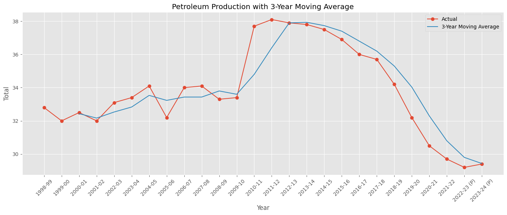

The moving average is calculated as:

$$
MA_t = \frac{Y_t+Y_{t-1}+Y_{t-2}}{3}
$$

Where $(Y_t)$ represents production in the current year and the preceding observations represent production in the previous two years.

> The following observations were made:

- The moving average provides a smoother representation of the underlying production trend compared to the original series.
- It captures the substantial increase in production around 2010–11 and the subsequent peak.
- The moving average reveals a sustained declining trend after the peak production period.
- The smoothed series also indicates that the decline towards the later years is not merely the result of isolated annual fluctuations.

he moving average confirms the presence of a long-term declining pattern in petroleum production, particularly during the later part of the observation period.

### 1.2.6 Autocorrelation and Partial Autocorrelation Analysis

Autocorrelation Function (ACF) and Partial Autocorrelation Function (PACF) plots were used to examine the temporal dependencies present in the petroleum production series.

**ACF Analysis:**

**Figure 1.2.6.1: ACF plot**

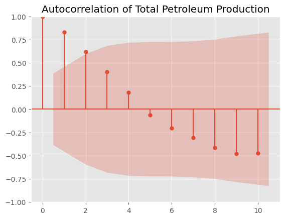

- The ACF plot exhibits strong positive autocorrelation at the initial lags.
- The autocorrelation gradually decreases as the lag increases.
- At higher lags, the autocorrelation becomes negative.
- This gradual decay indicates that the observations are influenced by previous time periods.

**PACF Analysis:**
**Figure 1.2.6: PACF plot**

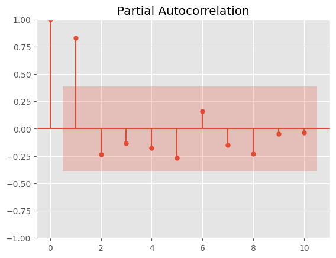

- The PACF plot shows a prominent positive spike at lag 1.
- Most of the remaining lags lie within the confidence intervals.
- This suggests that the most prominent direct relationship with the current observation is associated with the immediately preceding observation.

The ACF and PACF plots indicate the presence of temporal dependencies in the production series. These patterns provide preliminary insights into the autoregressive characteristics of the data and are useful when considering ARIMA model configurations.

### 1.2.7 Outlier Detection Using Z-Score

Z-score analysis was performed to identify observations that deviate significantly from the mean production level.

**Figure 1.2.7: z-score plot**

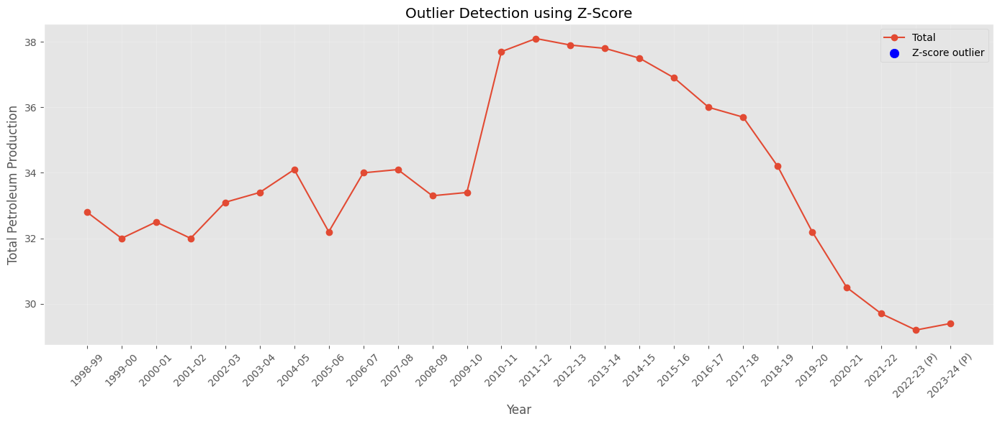

The Z-score is calculated using:

$$
Z_t = \frac{Y_t-\mu}{\sigma}
$$

Where:

$(Y_t)$ represents the observed production.

$(\mu)$ represents the mean production.

$(\sigma)$ represents the standard deviation.

A threshold of (|Z_t|>3) was considered for identifying potential outliers.

The visualization does not show any observations crossing the selected outlier threshold.

Based on the Z-score criterion, no significant statistical outliers were identified in the total petroleum production series.

### 1.2.8 Distribution Analysis Using Box Plot and Violin Plot

Box plots and violin plots were generated to examine the statistical distribution and variability of petroleum production.

**Figure 1.2.8: Box plot**

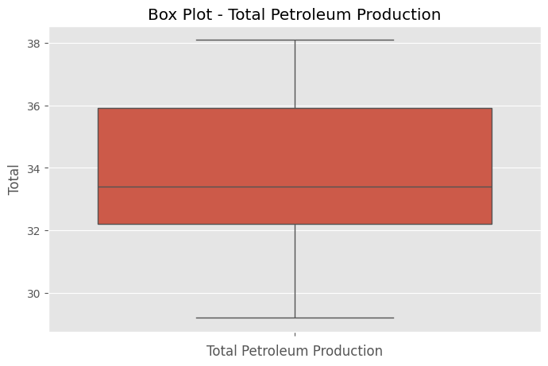

**Box Plot Analysis:**

- The median production is approximately 33.4 MMT.
- The interquartile range indicates the central distribution of production observations.
- The overall production values range approximately from 29.2 MMT to 38.1 MMT.
- No observations are visibly identified as outliers by the box plot.

**Violin Plot Analysis:**

Violin plots were used to examine the distribution of production across public sector undertakings, private sector organizations, and total petroleum production.

The plots indicate differences in the distribution and variability of production across these categories. The public sector exhibits a wider range of production values, while the private sector shows considerable variation associated with its increase and subsequent decline over the observation period.

The distribution analysis highlights the variability in petroleum production across the observation period. The box plot and violin plots provide complementary views of the distribution, helping to understand the spread and concentration of production values.

### 1.2.9 Summary of EDA Findings

The exploratory analysis revealed several important characteristics of the Indian petroleum production dataset:

- Petroleum production exhibits a changing long-term trend, with a noticeable peak around 2011–12 followed by a sustained decline.
- ONGC remains the largest contributor to domestic petroleum production, although its contribution has gradually decreased.
- Private sector production experienced significant growth around 2010–11, followed by a declining pattern.
- Year-over-year analysis reveals considerable fluctuations, including a significant increase in 2010–11 and predominantly negative growth in subsequent years.
- The three-year moving average confirms the underlying declining production trend.
- ACF and PACF analysis indicates the presence of temporal dependencies in the series.
- Z-score analysis does not identify any significant statistical outliers using the selected threshold.
- Distribution analysis highlights the variability in production across the observation period.The exploratory analysis revealed several important characteristics of the Indian petroleum production dataset:
- Petroleum production exhibits a changing long-term trend, with a noticeable peak around 2011–12 followed by a sustained decline.
- ONGC remains the largest contributor to domestic petroleum production, although its contribution has gradually decreased.
- Private sector production experienced significant growth around 2010–11, followed by a declining pattern.
- Year-over-year analysis reveals considerable fluctuations, including a significant increase in 2010–11 and predominantly negative growth in subsequent years.
- The three-year moving average confirms the underlying declining production trend.
- ACF and PACF analysis indicates the presence of temporal dependencies in the series.
- Z-score analysis does not identify any significant statistical outliers using the selected threshold.
- Distribution analysis highlights the variability in production across the observation period.

## 1.3 Stationarity Analysis

### 1.3.1 Concept of Stationarity

A time series is considered stationary when its statistical properties, such as mean, variance and autocovariance, remain approximately constant over time.

Stationarity is an important assumption in traditional ARIMA modelling because the model works with a series whose statistical behaviour does not change systematically over time.

A time series that exhibits a trend or changing statistical properties is generally considered non-stationary. Differencing is commonly applied to remove such trends and achieve stationarity.

First-order differencing is calculated as:
$Y'_t=Y_t-Y_{t-1}$

Where:

- $ (Y_t)$ represents the current observation.
- $ (Y_{t-1})$ represents the previous observation.
- $ (Y'_t)$ represents the differenced series.
  If first-order differencing is insufficient, further differencing can be investigated. However, excessive differencing should be avoided.

### 1.3.2 Stationarity Testing

To statistically examine the stationarity of the petroleum production series, two complementary statistical tests were considered:

1. Augmented Dickey-Fuller (ADF) Test

The ADF test checks for the presence of a unit root in a time series.

- Null hypothesis ($H_0$): The time series is non-stationary and contains a unit root.
- Alternative hypothesis ($H_1$): The time series is stationary.

Decision rule:

- If p-value is less than 0.05, reject the null hypothesis and conclude that the series is stationary.
- If p-value is greater than or equal to 0.05, fail to reject the null hypothesis.

2. Kwiatkowski-Phillips-Schmidt-Shin (KPSS) Test

The KPSS test examines stationarity by considering the null hypothesis that the series is stationary.

- Null hypothesis $(H_0)$: The time series is stationary.
- Alternative hypothesis $(H_1)$: The time series is non-stationary.
  Decision rule:
- If p-value is greater than 0.05, fail to reject the null hypothesis and consider the series stationary.
- If p-value is less than or equal to 0.05, reject the null hypothesis and conclude that the series is non-stationary.

> Stationarity Test Results

| Stationarity Test | Statistic | P-value | Result         |
| ----------------- | --------- | ------- | -------------- |
| ADF               | -1.887    | 0.337   | Non-stationary |
| KPSS              | 0.166     | 0.1     | Stationary     |

### 1.3.3 Differencing and Stationarity Results

The ADF and KPSS tests were performed on the petroleum production series after applying different orders of differencing.
The objective was to identify the minimum differencing order required to achieve stationarity.

The following results were obtained:

| Differencing   | ADF Statistic | ADF p-value | KPSS Statistic | KPSS p-value |
| -------------- | ------------- | ----------- | -------------- | ------------ |
| 1st Difference | -4.0665       | 0.0011      | 0.3408         | 0.1000       |
| 2nd Difference | -1.9459       | 0.3108      | 0.3947         | 0.0794       |
| 3rd Difference | -1.7809       | 0.3900      | 0.3662         | 0.0917       |
| 4th Difference | -0.9712       | 0.7636      | 0.4838         | 0.0453       |

> Interpretation of results:

- First-order differencing: The ADF p-value (0.0011) is below 0.05, indicating rejection of the unit-root null hypothesis. The KPSS p-value (0.1000) is above 0.05, indicating that the null hypothesis of stationarity cannot be rejected. Both tests support stationarity.
- Second-order differencing: The ADF p-value (0.3108) is above 0.05, suggesting non-stationarity, whereas the KPSS test does not reject stationarity.
- Third-order differencing: The ADF test continues to indicate non-stationarity, while the KPSS test does not reject stationarity.
- Fourth-order differencing: Both tests indicate non-stationarity at the 5% significance level.

### 1.3.4 Selection of Differencing Order

Based on the experimental results, first-order differencing was selected for the petroleum production series.

The first difference satisfies the stationarity criteria of both ADF and KPSS tests. Therefore, further differencing is unnecessary.

The selected differencing order is:

$$
\boxed{d=1}
$$

This indicates that the original petroleum production series requires one level of differencing to achieve stationarity.

### 1.3.5 Conclusion

The stationarity analysis was performed using the Augmented Dickey-Fuller (ADF) and KPSS tests to determine the appropriate differencing order for the Indian petroleum production time series.

The experimental results indicate that first-order differencing is sufficient to achieve stationarity. The ADF test produced a p-value of 0.0011, while the KPSS test reported a p-value of 0.1000. Both results support the stationarity of the first-differenced series at a 5% significance level.

Although higher-order differencing was also examined, it did not provide better statistical evidence of stationarity. Therefore, first-order differencing was selected, corresponding to a differencing order of d = 1.

# 2. Methodology

## 2.1 Steps Involved in the Proposed Methodology

The proposed methodology follows a systematic time-series forecasting approach to analyze and predict annual petroleum production in India. The process consists of the following stages:

**Step 1: Dataset Collection and Preparation**

Historical petroleum production data was collected from the Petroleum Planning & Analysis Cell (PPAC), Government of India. The dataset was organized chronologically, and the `Total` production variable was selected as the target variable for forecasting. Data preparation was performed to ensure consistency in the financial-year observations and production units.

**Step 2: Exploratory Data Analysis (EDA)**

Exploratory Data Analysis was conducted to understand the underlying characteristics of the production series. Various visualizations and statistical techniques were used to examine long-term trends, sector-wise contributions, annual percentage changes, moving averages, autocorrelation, distribution and potential outliers.

**Step 3: Stationarity Analysis**

The stationarity of the production series was examined using the Augmented Dickey-Fuller (ADF) and Kwiatkowski-Phillips-Schmidt-Shin (KPSS) tests. Differencing was applied to address non-stationarity, and the appropriate differencing order was determined based on the statistical test results.

**Step 4: Chronological Data Splitting**

The dataset was divided into training, validation and testing subsets while maintaining the chronological order of observations. This approach ensures that future observations are not used to predict past values and provides a more realistic evaluation of forecasting performance.

**Step 5: Forecasting Model Development**

Multiple time-series forecasting techniques were implemented to model petroleum production. These included Naïve Forecast, Drift Forecast, Holt's Linear Trend method and the ARIMA model. The models were selected to compare simple baseline forecasting techniques with more advanced statistical forecasting approaches.

**Step 6: Model Validation and Selection**

The forecasting models were evaluated using the validation dataset. Performance was assessed using Mean Absolute Error (MAE), Root Mean Squared Error (RMSE) and Mean Absolute Percentage Error (MAPE). These metrics were used to compare prediction accuracy and identify promising forecasting models.

**Step 7: Final Model Evaluation**

The selected forecasting model was evaluated on the held-out test dataset to examine its performance on previously unseen observations.

**Step 8: Residual Analysis and Visualization**

Residuals were examined to understand the difference between actual and predicted production values. Actual versus predicted plots, residual plots and other diagnostic visualizations were used to assess the forecasting performance.

**Step 9: Comparative Performance Analysis**

Finally, the forecasting models were compared based on their evaluation metrics. A comparative ranking was prepared to identify the model that provided the most accurate predictions for the Indian petroleum production series.

## 2.2 Description of Forecasting Models

| No. | Model                      | Category                |
| --- | -------------------------- | ----------------------- |
| 1   | Naïve Forecast            | Baseline                |
| 2   | Drift Forecast             | Baseline                |
| 3   | Holt's Linear Trend        | Exponential smoothing   |
| 4   | Holt's Linear Damped Trend | Exponential smoothing   |
| 5   | ARIMA(1,1,1)               | Statistical forecasting |

### 2.2.1 Naïve Forecast

The Naïve forecasting method is used as a baseline model. It assumes that the production value in the next period will remain equal to the most recently observed value.

$$
\hat{Y}_{t+h}=Y_t
$$

Where:

- $(Y_t)$ is the latest observed production.
- $(h)$ is the forecast horizon.
- $(\hat{Y}_{t+h})$ is the predicted production.
  Purpose: This model provides a simple benchmark against which the performance of more advanced forecasting models can be evaluated.

### 2.2.2 Drift Forecast

The Drift forecasting method extends the Naïve approach by incorporating the average historical change in the time series.

The average change is calculated as:

$$
d=\frac{Y_T-Y_1}{T-1}
$$

The forecast is then calculated as:

$$
\hat{Y}_{T+h}=Y_T+hd
$$

Where:

- $(Y_T)$ represents the latest observed value.
- $(Y_1)$ represents the first observed value.
- $(d)$ represents the average change per period.
- $(h)$ represents the forecast horizon.
  Purpose: This method considers the overall historical direction of production and extrapolates that trend into future periods.

### 2.2.3 Holt's Linear Trend Method

Holt's Linear Trend method is an exponential smoothing technique that models both the level and trend components of a time series.

It uses two smoothing equations:

Level equation:

$$
L_t=\alpha Y_t+(1-\alpha)(L_{t-1}+B_{t-1})
$$

Trend equation:

$$
B_t=\beta(L_t-L_{t-1})+(1-\beta)B_{t-1}
$$

The forecasting equation is:

$$
\hat{Y}_{t+h}=L_t+hB_t
$$

Where:

- $(L_t)$ represents the estimated level.
- $(B_t)$ represents the estimated trend.
- $(\alpha)$ is the level smoothing parameter.
- $(\beta)$ is the trend smoothing parameter.
- $(h)$ represents the forecast horizon.
  Purpose: This model captures the underlying level and linear trend in petroleum production and uses them to generate future forecasts.

Your implementation uses an additive trend with optimized parameters and no seasonal component.

### 2.2.4 Holt's Linear Damped Trend Method

Holt's Linear Damped Trend method is an extension of Holt's Linear Trend method. It introduces a damping parameter to gradually reduce the influence of the estimated trend as the forecast horizon increases.

Unlike the standard linear trend method, which assumes that the trend continues indefinitely at a constant rate, the damped trend method assumes that the trend gradually approaches zero.

The level equation is:

$$
L_t=\alpha Y_t+(1-\alpha)(L_{t-1}+\phi B_{t-1})
$$

The trend equation is:

$$
B_t=\beta(L_t-L_{t-1})+(1-\beta)\phi B_{t-1}
$$

The forecasting equation is:

$$
\hat{Y}_{t+h}=L_t+
\left(\sum_{i=1}^{h}\phi^i\right)B_t
$$

Where:

- $(phi)$ represents the damping parameter, typically between 0 and 1.
- $(L_t)$ represents the estimated level.
- $(B_t)$ represents the estimated trend.
- $(\alpha)$ and $(\beta)$ are smoothing parameters.
  Purpose: This method is useful when a historical trend is expected to continue but may weaken over time. It provides an alternative to the standard linear trend method for forecasting petroleum production.

Your implementation uses an additive trend, enables damped trend estimation and optimizes the model parameters.

### 2.2.5 Autoregressive Integrated Moving Average (ARIMA)

ARIMA is a statistical time-series forecasting model that combines autoregression, differencing and moving-average components.

It is represented by three parameters:

$$
ARIMA(p,d,q)
$$

Where:

- $(p)$: Order of the autoregressive (AR) component.
- $(d)$: Degree of differencing required to achieve stationarity.
- $(q)$: Order of the moving-average (MA) component.
  The general ARIMA equation can be expressed as:

$$
\phi(B)(1-B)^dY_t=c+\theta(B)\epsilon_t
$$

Where:

- $(B)$ represents the backshift operator.
- $(\phi(B))$ represents the autoregressive polynomial.
- $(\theta(B))$ represents the moving-average polynomial.
- $(\epsilon_t)$ represents the random error term.
  ARIMA(1,1,1)

Based on the validation experiments, ARIMA(1,1,1) was selected as the final ARIMA configuration.

Its components are:

- $(p=1)$: Uses one autoregressive term.
- $(d=1)$: Applies first-order differencing to address non-stationarity.
- $(q=1)$: Uses one moving-average term.
  The model incorporates the relationship between consecutive observations and past forecast errors to generate future petroleum production forecasts.

Purpose: ARIMA(1,1,1) captures temporal dependencies in the production series while accounting for its non-stationary behaviour through first-order differencing.

### 2.2.6 ARIMA Order Selection

Before finalizing the ARIMA configuration, multiple candidate ARIMA models were evaluated using the training and validation datasets.

The candidate configurations included:

- ARIMA(0,1,0)
- ARIMA(1,1,0)
- ARIMA(0,1,1)
- ARIMA(1,1,1)
- ARIMA(1,1,2)
  The models were fitted using the training dataset, and their forecasts were evaluated against the validation dataset.
  Validation RMSE was used as the primary selection criterion, while AIC was considered as a secondary criterion when comparing models.
  The configuration with the lowest validation RMSE was selected for subsequent forecasting experiments.
  The results indicated that ARIMA(1,1,1) achieved the lowest validation RMSE among the evaluated candidate configurations.

## 2.3 Flowchart of the Proposed Methodology

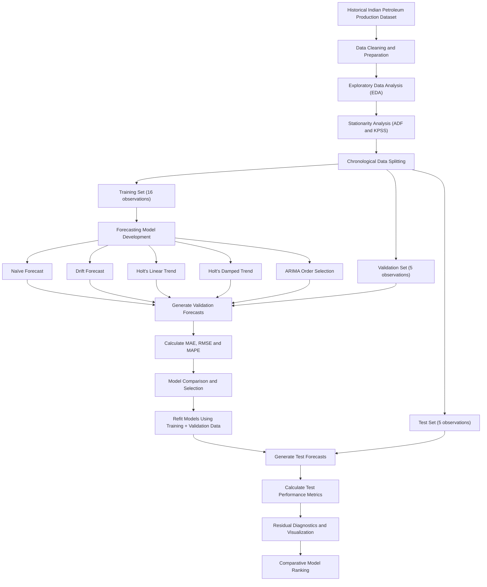

- The proposed forecasting pipeline begins with the collection and preparation of historical Indian petroleum production data. The prepared dataset is subjected to Exploratory Data Analysis (EDA) to identify underlying trends, variations, sector-wise contributions and temporal dependencies.
- Following EDA, stationarity is examined using the Augmented Dickey-Fuller (ADF) and KPSS tests. Differencing is applied where necessary to understand and address the non-stationary behaviour of the production series.
- The dataset is subsequently divided into training, validation and testing subsets while preserving chronological order. The training dataset is used to develop five forecasting models: Naïve Forecast, Drift Forecast, Holt's Linear Trend, Holt's Linear Damped Trend and ARIMA.
- For ARIMA, multiple candidate configurations are evaluated to identify an appropriate model order using validation performance. All forecasting models are then evaluated on the validation dataset using Mean Absolute Error (MAE), Root Mean Squared Error (RMSE) and Mean Absolute Percentage Error (MAPE).
- Based on validation performance, the models are compared and the forecasting configurations are selected. The models are subsequently refitted using the combined training and validation datasets, and their forecasting performance is evaluated on the held-out test dataset.
- Finally, residual diagnostics and graphical visualizations are performed to examine model behaviour and forecasting accuracy. A comparative ranking of the forecasting models is prepared to summarize their performance on the petroleum production series.

# 3. Results & Discussion

### 3.1 Dataset Splitting

The historical petroleum production dataset consists of 26 annual observations. To evaluate the forecasting models, the dataset was divided into training, validation and testing subsets using chronological splitting.

The first 16 observations were allocated to the training set, which was used for fitting the forecasting models. The subsequent 5 observations formed the validation set, which was used to compare model performance and select suitable model configurations. The remaining 5 observations were reserved as the testing set for final evaluation.

Chronological splitting was adopted instead of random sampling to preserve the temporal dependencies in the dataset and prevent information from future observations from influencing the forecasting process.

This approach provides a more realistic assessment of how the developed models would perform when forecasting future petroleum production.

| Training Observations | Validation observations | Testing observations | Training Period | Validation Period | Testing Period |
| ------ | ------ | ------ | ------ | ------ | ------ |
| 16 | 5 | 5 | 1998 - 2013 | 2014 - 2018 | 2019 - 2023 |

### 3.2 Stationarity Analysis

| Differencing   | ADF Statistic | ADF p-value | KPSS Statistic | KPSS p-value |
| -------------- | ------------- | ----------- | -------------- | ------------ |
| 0 Difference | -1.887 | 0.337 | 0.166 | 0.1 |
| 1st Difference | -4.0665       | 0.0011      | 0.3408         | 0.1000       |
| 2nd Difference | -1.9459       | 0.3108      | 0.3947         | 0.0794       |
| 3rd Difference | -1.7809       | 0.3900      | 0.3662         | 0.0917       |
| 4th Difference | -0.9712       | 0.7636      | 0.4838         | 0.0453       |

> Original v/s differenced series

**Figure 3.2:Original v/s differenced**

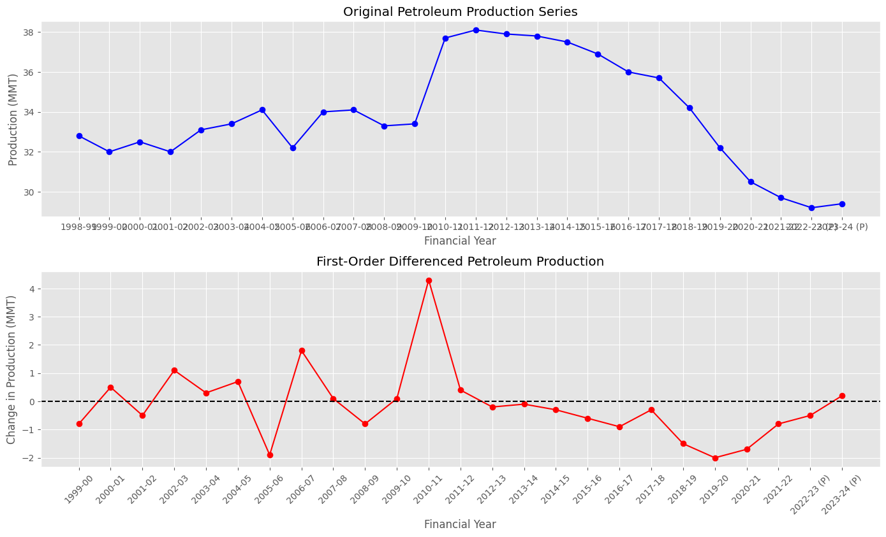

The stationarity tests indicate that first-order differencing is sufficient to achieve stationarity in the petroleum production series. Both ADF and KPSS tests support this conclusion at a 5% significance level. Therefore, the differencing parameter was selected as d = 1 for subsequent ARIMA modelling.

### 3.3 ARIMA Order Selection

Six ARIMA configurations were considered for model selection. Their performance was evaluated using Mean Absolute Error (MAE), Root Mean Squared Error (RMSE), and Akaike Information Criterion (AIC) on the validation dataset.

**Table 3.3: ARIMA Model Comparison on Validation Data**

| ARIMA Model | Validation MAE | Validation RMSE | AIC |
|---|---:|---:|---:|
| ARIMA(1,1,1) | 1.7074 | 2.0453 | 58.2019 |
| ARIMA(0,1,2) | 1.7213 | 2.0584 | 58.1414 |
| ARIMA(0,1,0) | 1.7400 | 2.0741 | 54.5291 |
| ARIMA(1,1,0) | 1.7497 | 2.0824 | 56.3437 |
| ARIMA(0,1,1) | 1.7555 | 2.0872 | 56.2801 |

**Figure 3.3: Arima RMSE comparision**

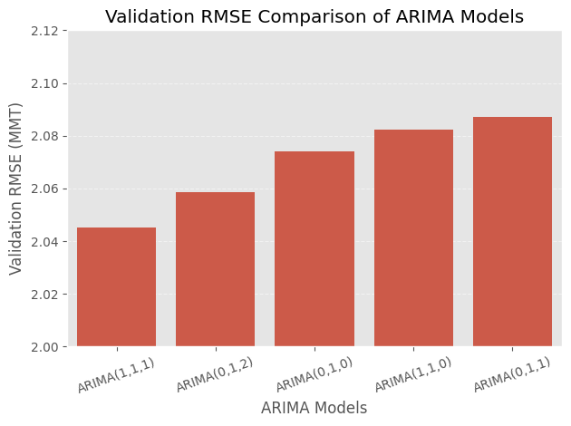

Based on validation RMSE, **ARIMA(1,1,1)** was selected as the best-performing configuration among the models displayed, achieving an RMSE of approximately 2.0453 MMT. This configuration was selected for further evaluation on the held-out test dataset.

### 3.4 Validation Results – Model Comparison

The five forecasting models were evaluated on the validation dataset using MAE, RMSE, and MAPE. The comparative results are presented below.

**Table 3.4: Validation Performance of Forecasting Models**

| Model | Validation MAE (MMT) | Validation RMSE (MMT) | Validation MAPE (%) |
|---|---:|---:|---:|
| ARIMA(1,1,1) | 1.7074 | 2.0453 | 4.8387 |
| Naïve Forecast | 1.7400 | 2.0741 | 4.9295 |
| Drift Forecast | 2.7400 | 3.1693 | 7.7458 |
| Holt's Linear Damped Trend | 2.9959 | 3.4119 | 8.4596 |
| Holt's Linear Trend | 3.0741 | 3.4983 | 8.6799 |

ARIMA(1,1,1) achieved the lowest error across all three evaluation metrics, followed closely by the Naïve Forecast. Both Holt's methods and the Drift Forecast produced comparatively higher errors. Based on these validation results, ARIMA(1,1,1) was selected for final evaluation on the held-out test dataset.

### 3.5 Test Results

The forecasting models were evaluated on the held-out test dataset consisting of five annual observations. The test performance was measured using MAE, RMSE, and MAPE.

**Table 3.5: Test Performance of Forecasting Models**

| Model | Test MAE (MMT) | Test RMSE (MMT) | Test MAPE (%) |
|---|---:|---:|---:|
| ARIMA(1,1,1) | 4.0000 | 4.1468 | 13.3887 |
| Naive | 4.0010 | 4.1478 | 13.3920 |
| Drift Forecast | 4.2100 | 4.3730 | 14.0953 |
| Holt's Linear Damped Trend | 4.2921 | 4.4429 | 14.3635 |
| Holt's Linear Trend | 4.3777 | 4.5382 | 14.6529 |

The Arima(1,1,1) Forecast achieved the lowest test errors across all three evaluation metrics, marginally outperforming Naive forecast. The difference between their performances is very small. Both models performed better than the Drift and Holt's forecasting methods on the test dataset.

**Figure 3.5: Performance**

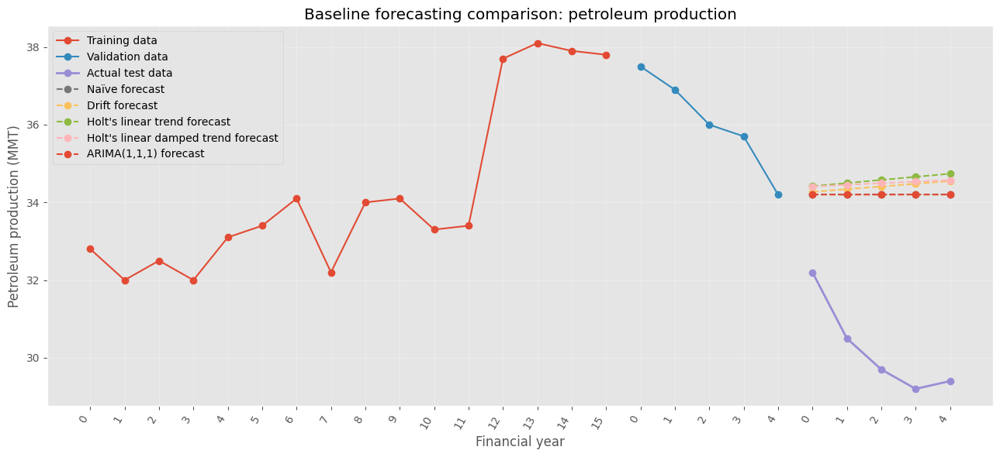

### 3.6 Residual Analysis

Residual diagnostics were performed on the ARIMA(1,1,1) model fitted using the combined training and validation datasets, consisting of 21 observations.

**Figure 3.6: Residual Plot of ARIMA(1,1,1)**

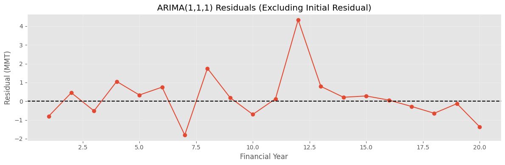

The residual plot shows that most residuals fluctuate around zero without a clear systematic trend. The initial residual is considerably larger than the remaining residuals, which may be associated with model initialization.

**Figure 3.7: ACF of ARIMA(1,1,1) Residuals**

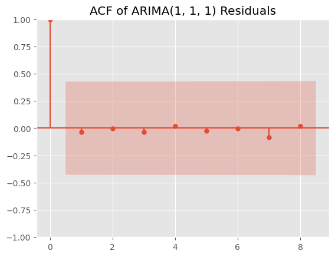

The residual ACF plot shows no prominent autocorrelation at the displayed non-zero lags, as the autocorrelation values remain within the confidence bounds.

**Table 3.6: Residual Diagnostic Test Results**

| Diagnostic | Statistic | p-value |
|---|---:|---:|
| Ljung–Box (lag 8) | 0.3646 | 0.9991 |
| Jarque–Bera | 20.49 | 0.00 |
| Heteroskedasticity | 0.41 | 0.27 |

The Ljung–Box test indicates no statistically significant residual autocorrelation at lag 8. However, the Jarque–Bera test indicates that the residuals deviate from normality. The heteroskedasticity test does not provide sufficient evidence of non-constant residual variance.

Overall, the residuals show no significant remaining autocorrelation, although the normality assumption is not satisfied.

### 3.7 Model Ranking

The forecasting models were ranked according to their RMSE on the held-out test dataset. A lower RMSE indicates better forecasting performance.

**Table 3.7: Final Ranking of Forecasting Models**

| Rank | Model | Test RMSE (MMT) | Test MAE (MMT) | Test MAPE (%) |
|---:|---|---:|---:|---:|
| 1 | Arima(1,1,1) | 4.1468 | 4.0000 | 13.3887 |
| 2 | Naive Forecast | 4.1478 | 4.0010 | 13.3920 |
| 3 | Drift Forecast | 4.3730 | 4.2100 | 14.0953 |
| 4 | Holt's Linear Damped Trend | 4.4429 | 4.2921 | 14.3635 |
| 5 | Holt's Linear Trend | 4.5382 | 4.3777 | 14.6529 |

Arima(1,1,1) achieved the lowest test RMSE, marginally outperforming the naive forecast. The difference between their RMSE values is approximately 0.0010 MMT, indicating very similar forecasting performance.

The results suggest that the more complex ARIMA and Holt's models did not provide a substantial improvement over the simple Naïve forecasting approach for the selected test period.

### 3.8 Future Petroleum Production Forecast

After completing model evaluation, the selected ARIMA(1,1,1) model was refitted using the complete historical dataset consisting of 26 annual observations. The refitted model was then used to forecast petroleum production for the next five years.

The forecast estimates and their corresponding 95% confidence intervals are presented below.

**Table 3.8: Petroleum Production Forecast using ARIMA(1,1,1)**

| Financial Year | Forecast (MMT) | Lower 95% CI | Upper 95% CI |
|---|---:|---:|---:|
| 2024–25 | 34.2004 | 31.7480 | 36.6528 |
| 2025–26 | 34.2007 | 30.8888 | 37.5133 |
| 2026–27 | 34.2010 | 30.3181 | 38.0839 |
| 2027–28 | 34.2013 | 29.9016 | 38.5010 |
| 2028–29 | 34.2015 | 29.5827 | 38.8203 |

The forecasts indicate a relatively stable petroleum production level of approximately 34.2 MMT over the five-year forecast horizon. The confidence intervals widen progressively with the forecast horizon, reflecting increasing uncertainty in longer-term predictions.

# 4. Visualization

## 4.1 Actual vs. Predicted Plot (y vs. y')

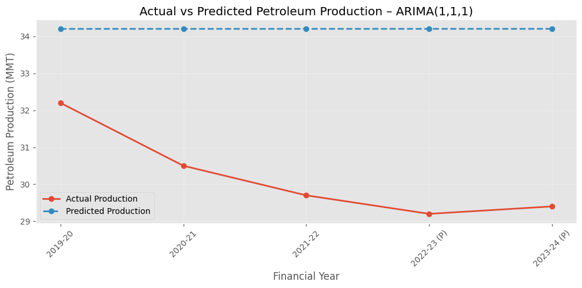

## 4.2 Actual vs. Predicted Scatter Plot

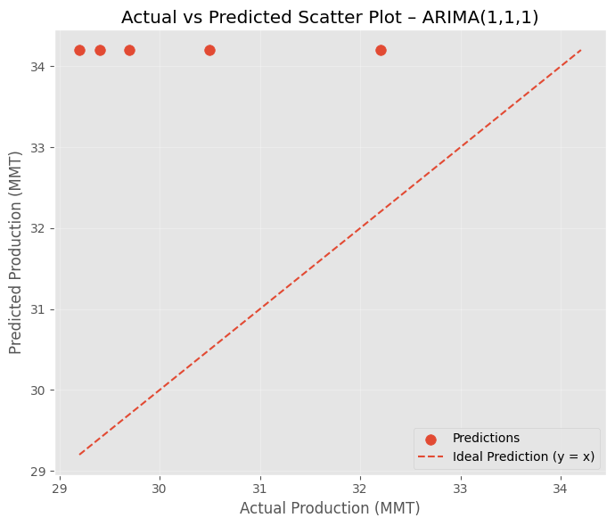

The scatter plot compares actual petroleum production values with the predictions generated by the ARIMA(1,1,1) model. The dashed diagonal represents the ideal prediction line (\(y=y'\)). All predicted values lie above the ideal line, indicating that the model consistently overestimated production during the test period. This is consistent with the declining trend observed in the actual production data.

## 4.3 Model Ranking Visualization

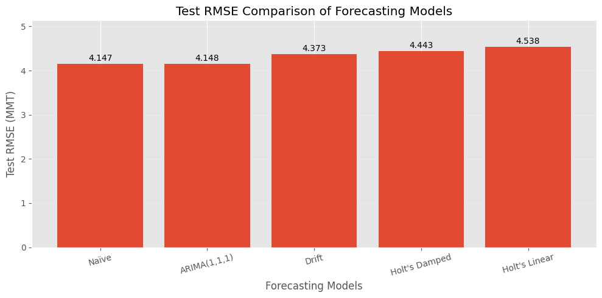

The bar chart compares the forecasting models based on their test RMSE values. The Naïve Forecast achieved the lowest RMSE of 4.147 MMT, closely followed by ARIMA(1,1,1) at 4.148 MMT. The Drift and Holt's methods recorded comparatively higher errors. These results indicate that the Naïve Forecast performed marginally better than the other evaluated models on the held-out test dataset.

### 4.4 Future Petroleum Production Forecast

**Figure 4.4: Historical and Forecasted Petroleum Production using ARIMA(1,1,1)**

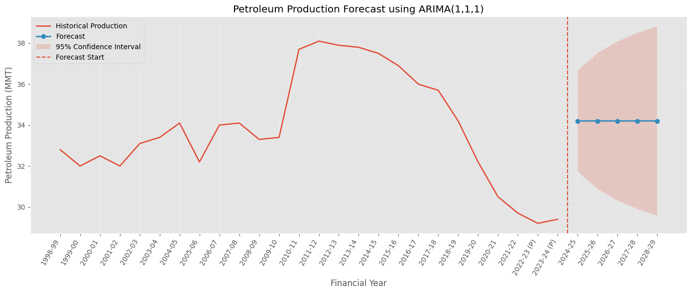

The visualization presents historical petroleum production along with the five-year forecasts generated by the final ARIMA(1,1,1) model. The vertical dashed line indicates the beginning of the forecast period, while the shaded region represents the 95% confidence interval.

The forecast suggests that petroleum production will remain approximately stable at 34.2 MMT over the forecast horizon. However, the widening confidence intervals indicate increasing uncertainty in the predicted values as the forecast horizon extends.

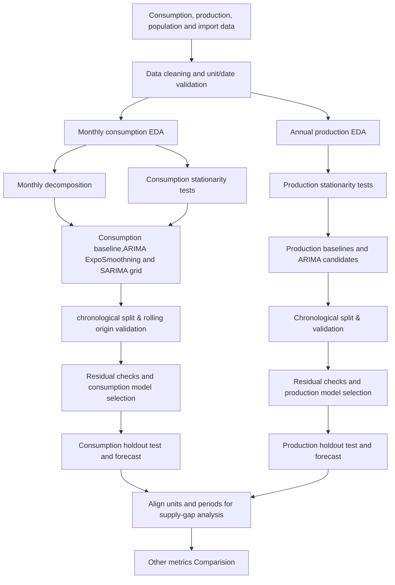