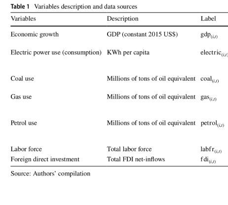
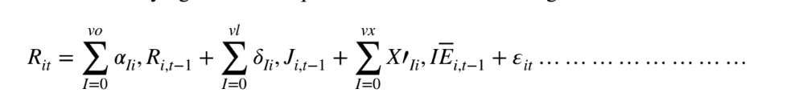
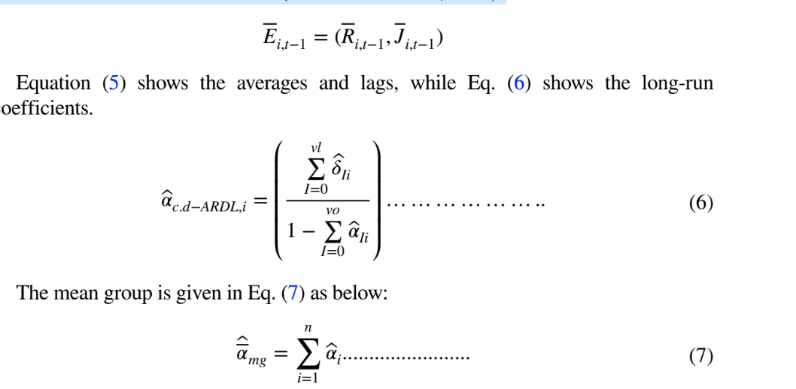
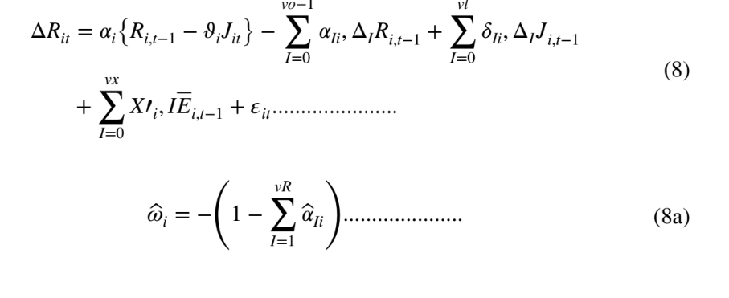
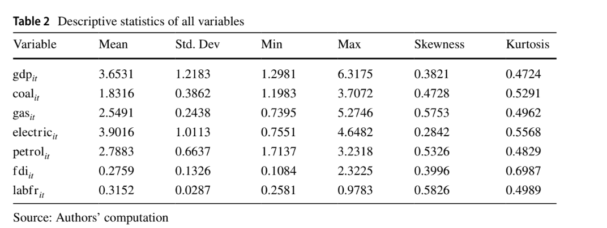
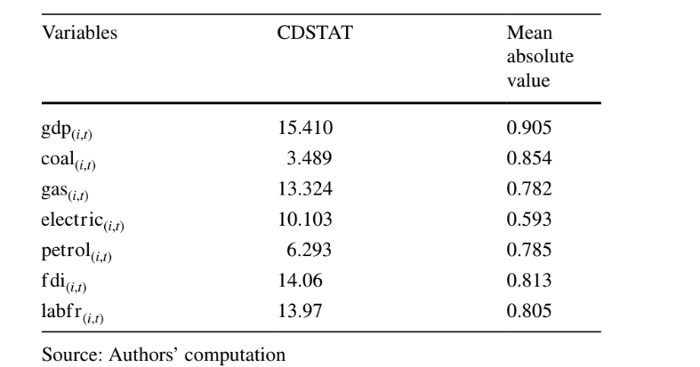
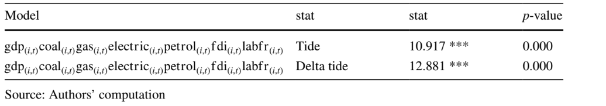
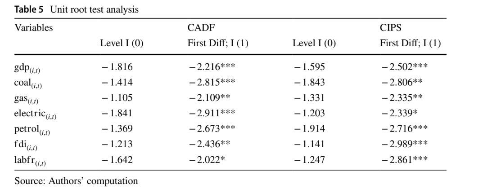
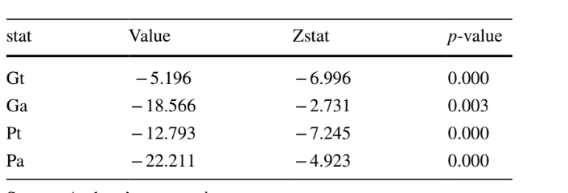
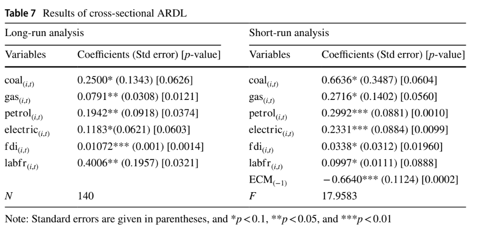

<h1 style="text-align:center">Exploring the Linkage Between Energy Consumption
and Economic Growth in BRICS Countries Through
Disaggregated Analysis</h1>

# Overview

- The main objective of this study is to analyze the impact of disaggregated energy
  consumption (coal, natural gas, petrol, and electricity) on the economic growth
  of BRICS countries (Brazil, Russia, India, China, and South Africa) from 1990 to 2020.
- The study implements the **Augmented Mean Group (AMG) and Cross- Sectional Augmented Autoregressive Distributed Lag (CS-ARDL)** techniques for empirical analysis. The cointegration results indicate a consistent long-term link between coal consumption, gas, petrol, electricity, and economic growth.
- The CS-ARDL estimates show that disaggregated energy consumption has a positive short and long-term effect on economic growth, and the AMG approach supports these findings.
- The **panel Granger** causality test result confirms the causal link between coal consumption and economic growth, electricity and economic growth, and petroleum and economic growth, supporting the feedback hypotheses,

# Literature Review

- Existing empirical studies reveal four perspectives on the causal relationship between
  energy use and economic progress.
- The first perspective is that energy usage Granger causes economic progress, known as the “growth hypothesis.”
- The second perspective suggests that economic growth Granger causes energy usage, known as the “conservation hypothesis.”
- The third perspective proposes that both economic growth and
  energy usage have bidirectional causality, known as the “feedback hypothesis” or bidirectional causality.
- The fourth perspective indicates no causality between economic development and energy usage, called the “neutrality hypothesis,”

> Petroleum Consumption-Economic Growth

- Several earlier research studies have examined the causal link between petroleum
  (oil) usage and economic development. For example, Aqeel and Butt (2001) study shows that growth leads to an expansion in petroleum usage in Pakistan from 1995
  to 1996.
- Lee and Chang (2005) study indicate a one-way causation from oil use to GDP in Taiwan from 1954 to 2003.
- Asghar (2008) assessed

the causal linkage between different sources of energy usage and economic progress
for a sample of 5 South Asian nations, namely, Pakistan, Sri Lanka, India, Nepal,
and Bangladesh.

# Method

- The selected variables are important due to their widespread usage.
  Furthermore, the analysis covers the period from 1990 to 2020 due to data availability.

  
- The multivariate regression model within the economic growth theory framework by
  Solow (1956) and Mankiw et al. (1992) and also used in many prior studies including Wang et al. (2023a), Azam (2022), Ali et al. (2022), Azam and Khan (2022), andAydin (2018) can be written as follows.

 gdp = $\alpha_0 + \alpha_1coal_{i,t} + α_2gas_{i,t} + α_3electric_{i,t} + α_4petrol_{i,t} + α_5fdi_{i,t} + α_6 labfr_{i,t} + \epsilon{i,t} ........... $

> Estimation Procedure

- possible. The study proceeds with **Pesaran** (2007) cross-sectional dependence (CSD) test. The CSD test is important to ensure unbiased estimates and estimator efficiency. We further applied the **Covariate Augmented Dickey-Fuller (CADF)** and Cross-sectionally augmented Im, **Pesaran and Shin (CIPS)** tests, to ascertain the stationarity properties of the variables. However, once variables are stationary, a cointegration test is
  required to determine the possibility of a long-run association.
- However, once variables are stationary, a cointegration test is
  required to determine the possibility of a long-run association. In this contribution, the
  **Westerlund (2007) test** investigates the existence of cointegration.
- Moreover, the traditional techniques provide partial output,
  leading to wrong policy implication suggestions. Therefore, this research analyzed the
  long- and short-run output analysis using Chudik and Pesaran (2015) CD-ARDL. The
  mathematical form is given as follows:
- $R_{it}=\sum_{l=0}^{v0}α_{li}R_{i,t−l}+\sum_{l=0}^{vl}δ_{li}J_{i,t−l}+ϵ_{it}$
- The problem with Eq. (4) is that it cannot solve the problems of the existence of
  a unit root, unobservable factors, slope-homogeneity, and cross-sectional-dependence.
  Therefore, modifying the above equation leads to the following:

  
- Using cross-section averages, Eq. (5) resolves the concerns in the above discussion
  and eliminates the threshold effect (Chudik & Pesaran, 2015).

  
- The short- and long-run coefficient analysis is calculated in Eq. (8) and given as
  follows:

  

# Results

- Descriptive Statistics:

  
- Cross-Sectional Dependence test analysis

  

  the results of the cross-sectional dependence test, which confirms
  the dependency among variables. The null hypothesis of no cross-section independ-
  ence is rejected. The high mean absolute value indicates high dependence, confirm-
  ing that shocks in one BRICS country will affect the others.
- Slope Homogenity Test analysis

  

  the results of the slope homogeneity test, with low p-values rejecting the null hypothesis of slope homogeneity. These results confirm the hetero-geneity in cross-sectional coefficients.
- Unit root test analysis
  

  confirming that all variables are non-stationary at level I (0) and stationary at the first difference, at various significance levels.
- Cointegration Test analysis

  

  co-integration analysis using the method of Westerlund (2007),
  showing long-run results. The lower p-value indicates a long-run association among
  the variables in this study.

- ARDL 

    