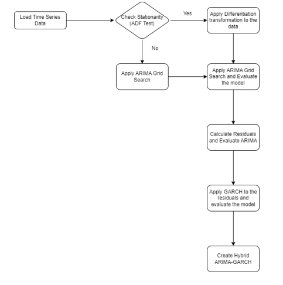
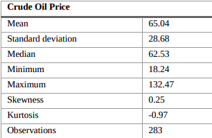
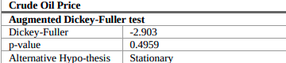
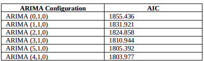
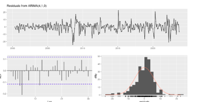
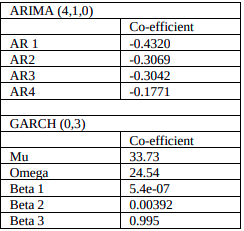

<h1 style="text-align: center;">Forecasting Indian crude oil Price Using Hybrid
ARIMA-GARCH Model.</h1>

# Overview

- `A commonly used forecasting
  method is the **Box–Jenkins method**, which uses **ARIMA**
  models.
- It can provide accurate forecasts over short periods,
  but it struggles to handle the volatility and nonlinearity of oil prices. Thus, this paper proposes a
  **hybrid ARIMA–GARCH model** to forecast oil prices.
- The data used for forecasting are monthly **Indian crude oil prices from April 2000 to October 2023**. The results show that the **ARIMA(4,2,0)–GARCH(0,3)** hybrid model is the most suitable for forecasting oil prices.
  The hybrid model provides better forecasts and is expected to be valuable to all stakeholders in the industry

# Literature Review

> Factors afecting oil price

- Miao, Ramchander, Wang, and
  Yang’s (2017) paper titled **"Influential Factors in Crude Oil
  Price Forecasting"** studies the key factors that play a
  significant role in predicting crude oil prices. It is a valuable
  contribution to the field of energy as it helps to identify the
  drivers and determinants that impact crude oil price
  forecasts.
- The paper by Sultan 2020 titled **”Empirical Investigation of
  Relationship between Oil Price and Inflation: The Case of
  India”** discusses the relationship between oil prices and
  inflation. It states that fluctuation in oil prices impacts
  inflation rates and provides insights into economic
  significance

> Forecasting oil price

- Shambulingappa’s (2020) titled
  **"Crude Oil Price Forecasting using Machine Learning"**
  discusses various machine learning techniques for predicting
  crude oil prices. This enables the integration of contemporary
  methods in forecasting commodities in the energy sector.
- Bhattacharya and Ahmed (2018) titled **"Forecasting Crude
  Oil Price Volatility in India using a Hybrid ANN-GARCH
  Model"** discusses an innovative approach to predicting crude
  oil prices using a hybrid model that combines an artificial
  neural network (ANN) and generalised autoregressive
  conditional heteroskedasticity (GARCH). This research has
  contributed to the Indian crude oil market by providing
  valuable insights.

# Research Method

> Box-Jenkins Method

- The Box–Jenkins Methodology (1976) is an approach for
  developing and designing ARIMA models for
  forecasting.
- The Box–Jenkins methodology has four steps:
  model identification, parameter estimation, diagnostic
  testing, and forecast evaluation.
- **ARIMA(p,q,d) :** $\phi_p(L)(1-L)^d(y_t - \mu) = \theta_q(L)e_t$

  where,

  $\phi_p(L) = 1 - \sum_{i=1}^q\phi_i{L^i}$,
  $\theta_q(L) = 1 - \sum_{i=1}^q\theta_i{L^i}$ are polynomials in
  terms of L of degrees p an q.

  $y_t$ is the time series ,
  $e_t$ is the error term at time t ,
  $\mu$ is the mean of the model
  d is the order of difference
  ∅𝑝 and 𝜗𝑗 are the parameters of autoregressive and moving average terms
  L is a difference operator defined as ∆𝑦𝑡 = 𝑦𝑡 - 𝑦𝑡−1 = (1-L) 𝑦𝑡

> Grid Search Method

- The Grid Search method is a comprehensive ML approach
  that rigorously explores a range of potential ARIMA model
  configurations that vary AR (p), differencing(d), and MA(q)
  parameters within a specified range. The method aims at
  minimising criteria such as the Aikaike Information
  Criterion (AIC) or Bayesian Information Criterion (BIC).

> Hetroskedastic Modelling

- The ARIMA model fails to consider the volatility of the
  variables. Generalized autoregressive conditional
  heteroskedasticity (GARCH) models are used to model
  financial time series with varying volatility
  Bollerslev’s(1986) proposed GARCH(r,s) model[13], as
  given below:

  $𝑦_𝑡 = 𝜇_𝑡 + 𝑧_𝑡$

  Where,
  $𝜇_𝑡$ is conditional mean of $𝑦_𝑡$
  Z is the shock at time t
  $𝑧_𝑡 = 𝜎_𝑡 𝑒_𝑡$
  Where
  $𝑒_𝑡$ → 𝑖𝑖𝑑 𝑁(0,1) and
  ${𝜎_𝑡}^2 = 𝛼_0 + \sum_{i=1}^r𝛼_𝑖 z_{t-1}^2 + \sum_{i=1}^s𝛽_𝑖𝜎_{𝑡−1}^2$
  Where,
  $𝜎_t^2$ is the conditional variance of 𝑦𝑡,
  $𝛼_0$ is a constant term,
  r is the order of the ARCH terms
  s is the order of the GARCH terms
  𝛼𝑖 and 𝛽𝑖 are the coefficients of the ARCH and GARCH parameters
  respectively

> Hybrid ARIMA-GARCH Model

- The ARIMA model captures only the linear and stationary
  aspects of the data, whereas the residuals and the remaining
  nonlinear patterns are isolated. The hybrid ARIMA–
  GARCH model involves a two-stage process: initially, the
  ARIMA model is built, and then, in a subsequent stage, the
  GARCH model is built to analyse the residuals
- GARCH - paper

> Statistics

- 
- The results show that the mean oil price (65.04)
  is quite higher than the standard deviation (28.68) indicating
  the price volatility. The skewness of 0.25 says that the
  dataset is slightly positively skewed, implying longer tails,
  whereas the kurtosis of -0.97 indicates that the distribution
  has thinner tails than a normal distribution with fewer and
  fewer extreme outliers
- **Dickey– Fuller (ADF) test** : confirm that crude oil prices are non-stationary in
  their levels, and the probability value is greater than the
  significance level of 0.05 (5%). Thus, a differentiation
  transformation is performed to obtain the stationary time
  series data.

  

> Emperical Results

- In consideration of the comprehensive scope, values of p and
  q are taken up to 20
- The table below shows only the top 5
  configurations that exhibited the most favorable model
  fits.

  
- ARIMA (4,1,0) model is the most suitable for
  crude oil prices. This configuration implies that a first-order
  difference was necessary to achieve stationarity, and the
  model includes AR terms (p=4) without moving average
  terms (q=0). The AIC for the ARIMA (4,1,0) is 1803.977
  and the RMSE is 5.87.
- ARIMA (4,1,0) model. The autocorrelation for residuals indicates the volatility in
  the dataset and the need for the GARCH model

  
- From the ACF and PACF plots of the Squared Residuals and
  Grid method, the most suitable Hybrid model is
  ARIMA(4,1,0)-GARCH(0,3). The following Table  shows the
  coefficients of the Hybrid Model.

  

# Forecasting

- After obtaining results from the ARIMA (mean modelling)
  and GARCH (variance modelling), crude oil price is
  predicted for the next 1 month. From the above modelling
  results, a model that is good enough to represent Indian
  crude oil price data is the ARIMA (4,1,0)-GARCG (0,3)
  model. The forecast for November 2023 is 87.26, which is
  very close to the actual value of 87.09. This suggests that the
  model has less than 1% error.
